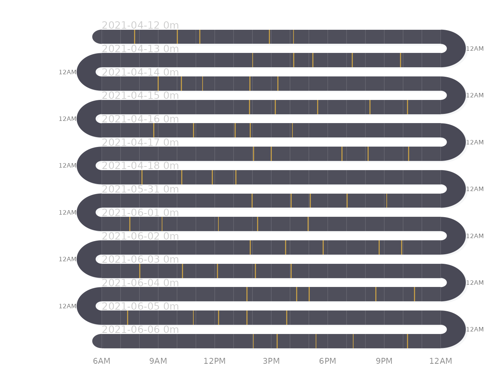
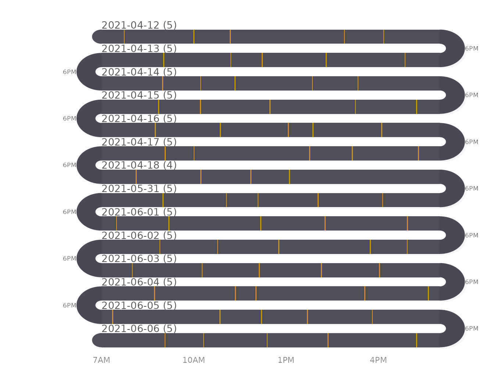
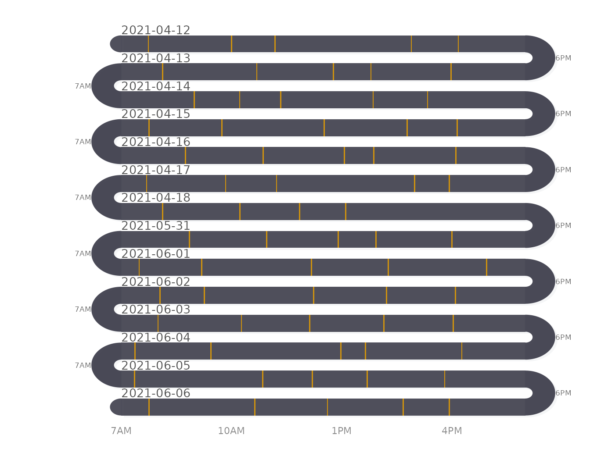
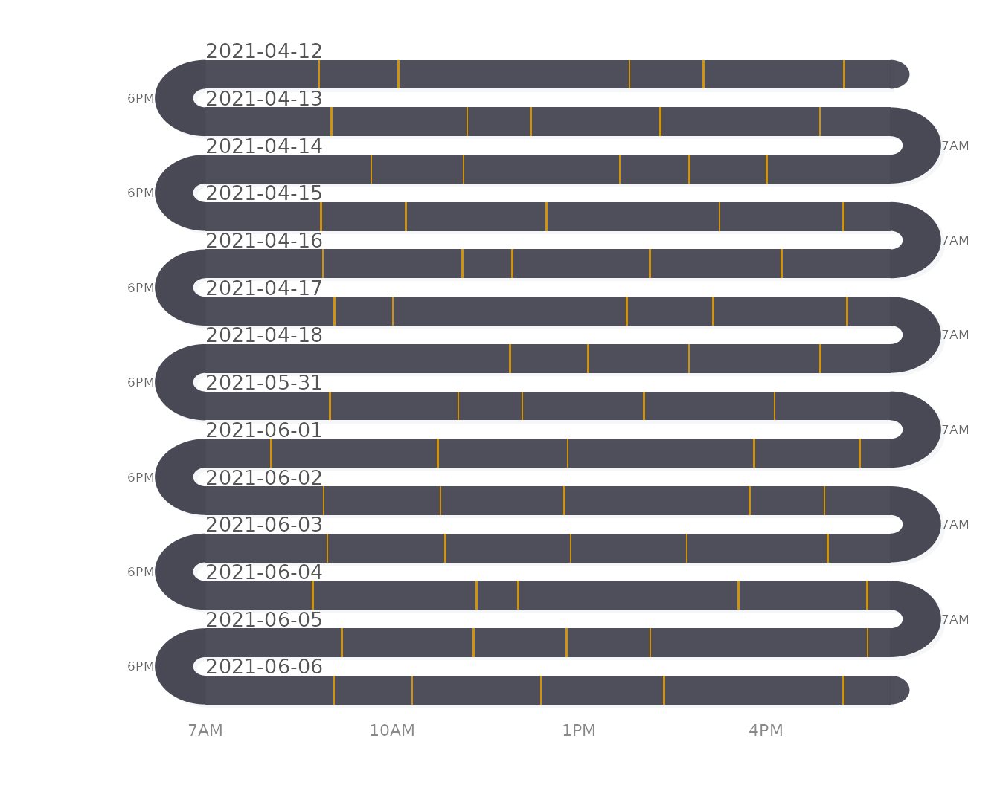
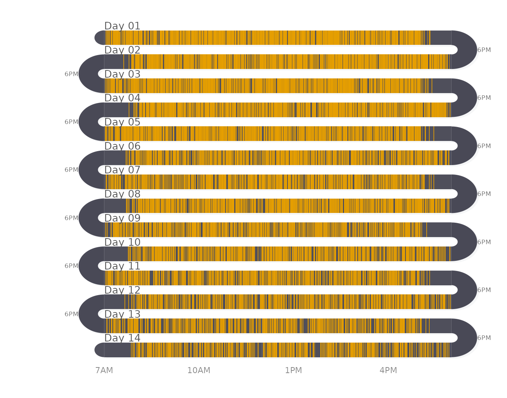
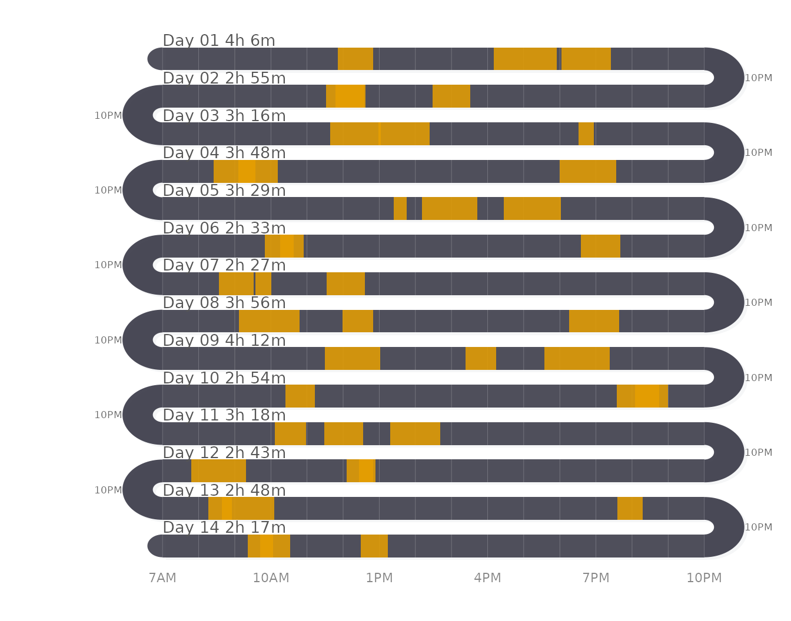
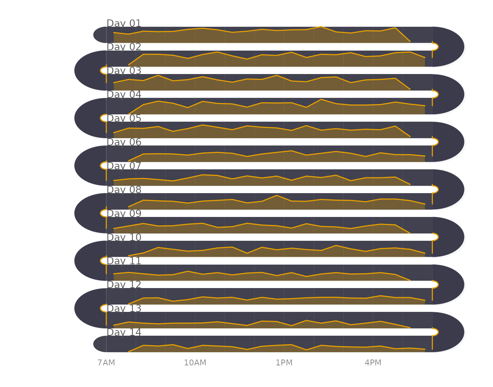
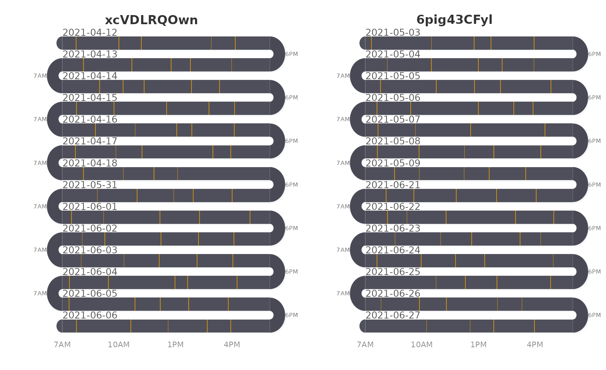

# Daily activity and continuous signals

Time-stamped events have two clocks: the calendar, which orders the
days, and the time of day, which places each event within its day. A
single time axis over two weeks compresses each day into a sliver and
hides daily routines; fourteen separate panels hide the continuity from
one day to the next. A snake plot gives each day its own band on a
shared clock and joins the bands through U-turn arcs that stand for the
night, so the same hour lines up across days and the days remain one
ordered series.

This guide covers
[`activity_snake()`](https://pak.dynasite.org/Snakeplot/reference/activity_snake.md)
for events (instants drawn as rug ticks, episodes drawn as duration
blocks), the clock window (`day_start`, `day_end`) and reading order
(`flow`, `start_from`),
[`line_snake()`](https://pak.dynasite.org/Snakeplot/reference/line_snake.md)
for a continuous signal measured through the day, and
[`facet_snake()`](https://pak.dynasite.org/Snakeplot/reference/facet_snake.md)
for side-by-side panels. Categorical sequences are covered in [the
sequences
guide](https://pak.dynasite.org/Snakeplot/articles/sequences.md).

``` r

library(snakeplot)
set.seed(2024)
```

The seed is set once because one example below uses simulated study
sessions; every other example uses the bundled data.

## Data

`ema_beeps` holds the answered prompts (“beeps”) of an experience
sampling study of university students over 14 study days (Neubauer &
Schmiedek, 2024; data CC-BY 4.0 at <https://osf.io/bhq3p>).

- **Participant:** `id` — anonymised identifier.
- **Study day:** `day` — 1 to 14.
- **Event time:** `start_time` — date and clock time of the answered
  beep (POSIXct). This is the column the activity plots use.
- **Ratings:** `happy`, `angry` — emotion ratings on a 1–5 scale, not
  used in this guide.

``` r

with(ema_beeps, c(beeps = length(id), participants = length(unique(id)),
                  days = length(unique(day))))
#>        beeps participants         days 
#>        11474          321           14
```

The data hold 11,474 answered beeps from 321 participants.

## One participant’s beeps as a rug

The first question is when participant `xcVDLRQOwn` answered the beeps:
on which dates, and at which times of day. The beeps are selected with
[`subset()`](https://rdrr.io/r/base/subset.html) and counted by calendar
date; the earliest and latest clock times are computed as well.

``` r

one <- subset(ema_beeps, id == "xcVDLRQOwn", select = start_time)
with(one, table(date = as.Date(start_time)))
#> date
#> 2021-04-12 2021-04-13 2021-04-14 2021-04-15 2021-04-16 2021-04-17 2021-04-18 2021-05-31 
#>          5          5          5          5          5          5          4          5 
#> 2021-06-01 2021-06-02 2021-06-03 2021-06-04 2021-06-05 2021-06-06 
#>          5          5          5          5          5          5
with(one, range(format(start_time, "%H:%M")))
#> [1] "07:20" "16:55"
```

The participant answered 69 beeps on 14 dates: five on every date except
18 April, which has four. The dates form two blocks of seven consecutive
days, 12–18 April and 31 May–6 June 2021, so the 14 study days are two
separate weeks. All answers fall between 07:20 and 16:55.

[`activity_snake()`](https://pak.dynasite.org/Snakeplot/reference/activity_snake.md)
accepts a data frame with a single POSIXct column. Each date becomes one
band, each beep one tick at its clock time, and the bands use the
default window from 6AM to midnight.

``` r

activity_snake(one)
```



Each band is one date, labelled with the date and the total duration of
its events (zero for instantaneous events). Each tick marks the clock
time of one beep. With the default window the hours from 6AM to 07:20
and from 16:55 to midnight hold no events at all.

## Fitting the clock window

`day_start` and `day_end` set the window in minutes from midnight. A
window from 7AM (420) to 6PM (1080) contains every beep computed above
and gives the answered hours the full band width. `show_total = FALSE`
drops the duration from the labels, because instantaneous events have no
duration; `show_grid = FALSE` removes the hour grid lines, which are
drawn as thin vertical lines like the ticks themselves; and a darker
`label_color` makes the date labels easier to read on a white page.

``` r

activity_snake(one, day_start = 420, day_end = 1080,
               show_total = FALSE, show_count = TRUE, show_grid = FALSE,
               label_color = "#555555", event_color = "#E69F00")
```



The same 69 ticks now spread over a window of 11 hours instead of 18, so
beeps that sat close together in the default plot are further apart. The
count in each label repeats the date table above.

## Reading order: flow and start_from

By default
[`activity_snake()`](https://pak.dynasite.org/Snakeplot/reference/activity_snake.md)
alternates the reading direction (`flow = "snake"`): the first band runs
from 7AM on the left to 6PM on the right, the arc carries the reader to
the next band, which runs from 7AM on the right to 6PM on the left, and
so on. Each arc therefore joins the end of one day to the start of the
next, but the same clock time sits on opposite sides in alternate bands.
With `flow = "natural"` every band runs from `day_start` on the left to
`day_end` on the right, so a given hour sits at the same horizontal
position in every band.

``` r

activity_snake(one, day_start = 420, day_end = 1080, flow = "natural",
               show_total = FALSE, show_grid = FALSE,
               label_color = "#555555", event_color = "#E69F00")
```



For comparisons of time of day across days, such as whether the first
beep is answered earlier on some dates than on others, the natural flow
is the right choice because the clock is aligned across bands.
`start_from = "right"` mirrors the layout, so the first band starts on
the right; in natural flow every band then runs from right to left.

``` r

activity_snake(one, day_start = 420, day_end = 1080, flow = "natural",
               start_from = "right", show_total = FALSE, show_grid = FALSE,
               label_color = "#555555", event_color = "#E69F00")
```



## The cohort: when ticks saturate

The same question for the whole cohort is when in the day the 321
participants answer. Pooling across participants requires one band per
study day rather than per calendar date, because participants started on
different dates.
[`activity_snake()`](https://pak.dynasite.org/Snakeplot/reference/activity_snake.md)
also accepts a data frame with `day` (a label), `start` (minutes from
midnight) and `duration` (minutes; 0 for an instant), which
[`transform()`](https://rdrr.io/r/base/transform.html) builds from the
time stamps.

``` r

cohort <- transform(ema_beeps,
                    day = sprintf("Day %02d", day),
                    start = 60 * as.integer(format(start_time, "%H")) +
                            as.integer(format(start_time, "%M")),
                    duration = 0)
with(cohort, table(hour = start %/% 60))
#> hour
#>    7    8    9   10   11   12   13   14   15   16   17 
#>  979 1184 1089 1291 1112 1241 1048 1232  990 1197  111
with(cohort, table(day))
#> day
#> Day 01 Day 02 Day 03 Day 04 Day 05 Day 06 Day 07 Day 08 Day 09 Day 10 Day 11 Day 12 
#>   1161   1110   1050    985    924    779    756    853    729    735    689    630 
#> Day 13 Day 14 
#>    537    536
```

Every beep falls between 7:00 and 17:59. The hourly counts lie between
979 and 1,291 for the hours from 7 to 16 and drop to 111 in the hour
from 17:00, so beeps are spread evenly over the day until the last hour.
The number of beeps per study day falls from 1,161 on day 1 to 536 on
day 14.

``` r

activity_snake(subset(cohort, select = c(day, start, duration)),
               day_start = 420, day_end = 1080, tick_width = 1,
               show_total = FALSE, label_color = "#555555",
               event_color = "#E69F00")
```



Each band now holds between 536 and 1,161 ticks, one per beep answered
on that study day. At this density the ticks overlap, and the rug
encodes little more than the window in which beeps occur: a rug is
suited to tens of events per band, not hundreds. When events are this
dense, counting them per time bin and drawing the counts as a continuous
signal, as in the
[`line_snake()`](https://pak.dynasite.org/Snakeplot/reference/line_snake.md)
section below, keeps the information the rug loses.

## Episodes with a duration

Events with a length (study sessions, meetings, sleep) are drawn as
blocks whose width is the duration. No bundled data set records
durations, so this example simulates three study sessions on each of 14
days, starting between 8:00 and 20:00 and lasting 20 to 120 minutes.

``` r

sessions <- data.frame(
  day      = rep(sprintf("Day %02d", seq_len(14)), each = 3),
  start    = round(runif(42, min = 480, max = 1200)),
  duration = round(runif(42, min = 20, max = 120))
)
head(sessions)
#>      day start duration
#> 1 Day 01  1083       82
#> 2 Day 01   711       59
#> 3 Day 01   970      105
#> 4 Day 02   983       65
#> 5 Day 02   809       62
#> 6 Day 02   985       48
aggregate(duration ~ day, data = sessions, FUN = sum)
#>       day duration
#> 1  Day 01      246
#> 2  Day 02      175
#> 3  Day 03      196
#> 4  Day 04      228
#> 5  Day 05      209
#> 6  Day 06      153
#> 7  Day 07      147
#> 8  Day 08      236
#> 9  Day 09      252
#> 10 Day 10      174
#> 11 Day 11      198
#> 12 Day 12      163
#> 13 Day 13      168
#> 14 Day 14      137
```

The daily study time ranges from 137 to 252 minutes across the 14
simulated days.

``` r

activity_snake(sessions, day_start = 420, day_end = 1320,
               event_color = "#E69F00", label_color = "#555555")
```



Each block starts at the session’s start time and is as wide as its
duration; the label of each band gives the total for that day, which is
the sum in the table above written in hours and minutes. Overlapping
sessions are drawn on top of each other in the same band.

## Continuous signals: line_snake

[`line_snake()`](https://pak.dynasite.org/Snakeplot/reference/line_snake.md)
(experimental; its interface may change) draws a numeric signal measured
through the day as a line inside each band. The input is a data frame
with `day`, `time` (minutes from midnight) and `value`. The signal here
is the answering rate of the cohort: the number of beeps answered in
each 30-minute bin of each study day, placed at the middle of the bin.

``` r

beep_rate <- aggregate(value ~ day + time,
                       data = transform(cohort, value = 1,
                                        time = 30 * (start %/% 30) + 15),
                       FUN = sum)
head(beep_rate)
#>      day time value
#> 1 Day 01  435    49
#> 2 Day 02  435    44
#> 3 Day 03  435    38
#> 4 Day 04  435    41
#> 5 Day 05  435    27
#> 6 Day 06  435    29
summary(with(beep_rate, value))
#>    Min. 1st Qu.  Median    Mean 3rd Qu.    Max. 
#>       3      31      39      39      48      75
```

The table has one row per study day and half-hour bin in which at least
one beep was answered. The number of beeps per bin ranges from 3 to 75,
with a median of 39.

``` r

line_snake(beep_rate, day_start = 420, day_end = 1080,
           line_color = "#E69F00", fill_color = "#E69F00",
           label_color = "#555555")
```



Each band is one study day from 7AM to 6PM, and the height of the line
within the band is the number of beeps in the half-hour bin. The values
are scaled to the band height over the whole plot, so heights are
comparable across days. Bins with no answered beep are absent from the
table, and the line joins the neighbouring bins across them.

## Side-by-side panels: facet_snake

[`facet_snake()`](https://pak.dynasite.org/Snakeplot/reference/facet_snake.md)
splits a data frame by one column and draws one panel per value, passing
the remaining columns and any further arguments to the plotting function
([`activity_snake()`](https://pak.dynasite.org/Snakeplot/reference/activity_snake.md)
by default). The question here is whether two participants with similar
numbers of answered beeps answer at similar times.

``` r

pair <- subset(ema_beeps, id %in% c("xcVDLRQOwn", "6pig43CFyl"),
               select = c(id, start_time))
with(pair, table(id))
#> id
#> 6pig43CFyl xcVDLRQOwn 
#>         67         69
```

Participant `6pig43CFyl` answered 67 beeps and `xcVDLRQOwn` 69.

``` r

facet_snake(pair, "id", day_start = 420, day_end = 1080,
            flow = "natural", show_total = FALSE, show_grid = FALSE,
            label_color = "#555555", event_color = "#E69F00")
```



Each panel is the natural-flow rug of one participant, titled with the
participant’s identifier, on the same 7AM–6PM window, so tick positions
can be compared across panels as well as across bands.

## When to use which

- **Instants, up to about a hundred per band:**
  [`activity_snake()`](https://pak.dynasite.org/Snakeplot/reference/activity_snake.md)
  with rug ticks (`duration = 0` or a bare time stamp column).
- **Episodes with a length:**
  [`activity_snake()`](https://pak.dynasite.org/Snakeplot/reference/activity_snake.md)
  with a `duration` (or an `end` time stamp); the band label gives the
  daily total.
- **Hundreds of events per band, or a measured quantity:** aggregate per
  time bin and draw the result with
  [`line_snake()`](https://pak.dynasite.org/Snakeplot/reference/line_snake.md).
- **Comparing persons or groups:**
  [`facet_snake()`](https://pak.dynasite.org/Snakeplot/reference/facet_snake.md)
  with the grouping column.
- **Comparing clock times across days:** `flow = "natural"` and a window
  (`day_start`, `day_end`) that matches the data.

## Reference

Neubauer, A. B., & Schmiedek, F. (2024). Approaching academic adjustment
on multiple time scales. *Zeitschrift für Erziehungswissenschaft,
27*(1), 147–168. <https://doi.org/10.1007/s11618-023-01182-8>
