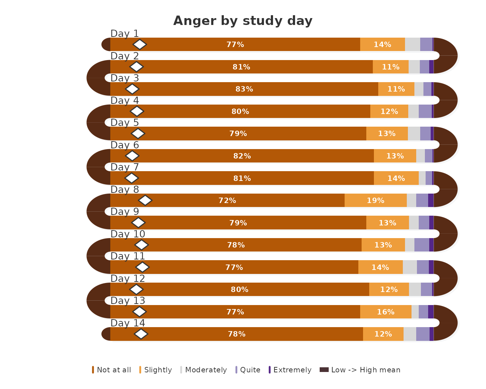
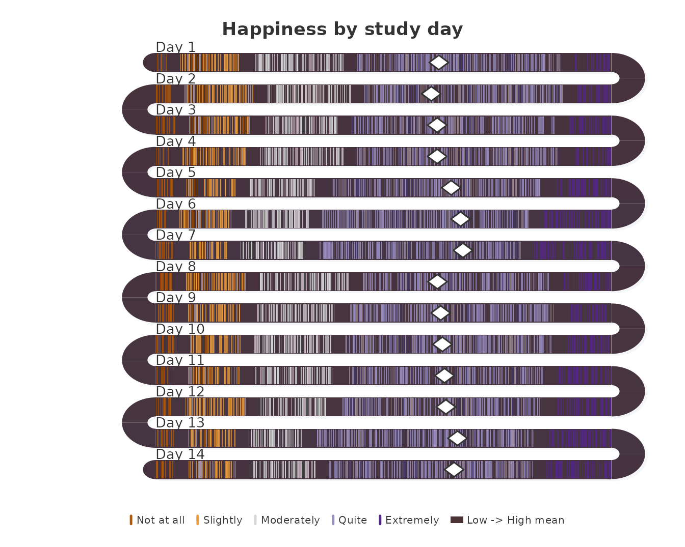
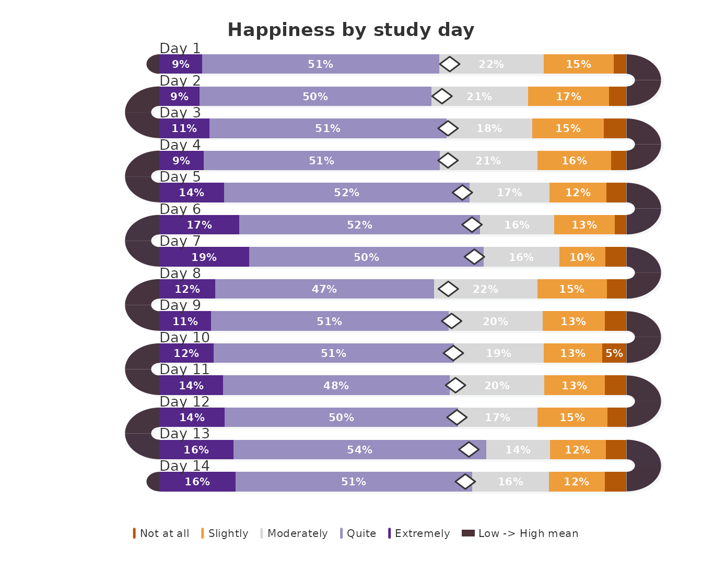
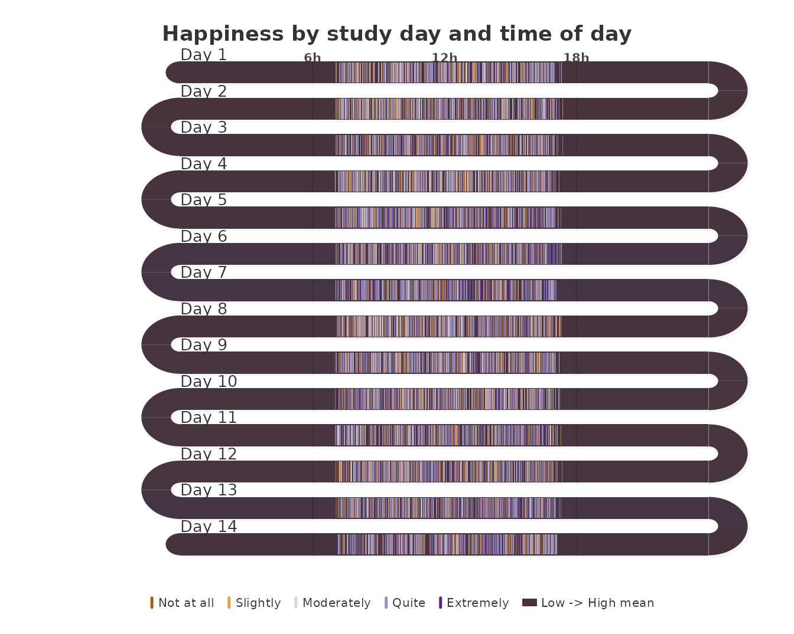

# Case study: daily emotions over fourteen days

Experience sampling studies ask participants to report their current
state several times a day over days or weeks. The resulting data answer
questions that a single questionnaire cannot: whether emotions change
over the course of a study, whether some days differ from others, and
whether the time of day matters. They also raise a presentation problem.
Averaging each day to one number hides how the responses are
distributed, and a separate histogram for each day spreads the
comparison over many panels. A snake plot of the daily distributions
keeps one band per day in study order, so the distribution of every day
and its change from one day to the next are read in one figure.

This case study analyses the anger and happiness ratings of a cohort of
university students over 14 study days. It first establishes the
structure of the study (which days, how many answers), then asks whether
the share of high-anger answers changes over the study, whether
happiness differs between weekdays and weekends, and when in the day the
answers are given. Each question is answered first with numbers computed
from the data and then with
[`survey_snake()`](https://pak.dynasite.org/Snakeplot/reference/survey_snake.md)
in its experience sampling mode (`var`, `day`, `timestamp`).

``` r

library(snakeplot)
```

## Data

`ema_beeps` holds every answered prompt (“beep”) of the experience
sampling study of Neubauer and Schmiedek (2024; data CC-BY 4.0 at
<https://osf.io/bhq3p>). Each row is one beep.

- **Participant:** `id` — anonymised identifier; beeps are nested within
  participants.
- **Study day:** `day` — 1 to 14; one band per day in the plots.
- **Time stamp:** `start_time` — date and clock time of the beep.
- **Happiness:** `happy` — 1 (not at all) to 5 (extremely), rescaled
  from the original 1–7.
- **Anger:** `angry` — 1 (not at all) to 5 (extremely), rescaled from
  the original 1–7.

``` r

with(ema_beeps, c(beeps = length(id), participants = length(unique(id))))
#>        beeps participants 
#>        11474          321
scale_labels <- c("1" = "Not at all", "2" = "Slightly", "3" = "Moderately",
                  "4" = "Quite", "5" = "Extremely")
```

The data hold 11,474 beeps from 321 participants. `scale_labels` maps
the five levels to the labels shown in the legends.

## The structure of the study

Before comparing days, it is necessary to know what a study day is. The
first question is on which weekday each study day falls.

``` r

with(ema_beeps, table(day, weekday = format(start_time, "%a")))
#>     weekday
#> day   Fri  Mon  Sat  Sun  Thu  Tue  Wed
#>   1     0 1161    0    0    0    0    0
#>   2     0    0    0    0    0 1110    0
#>   3     0    0    0    0    0    0 1050
#>   4     0    0    0    0  985    0    0
#>   5   924    0    0    0    0    0    0
#>   6     0    0  779    0    0    0    0
#>   7     0    0    0  756    0    0    0
#>   8     0  853    0    0    0    0    0
#>   9     0    0    0    0    0  729    0
#>   10    0    0    0    0    0    0  735
#>   11    0    0    0    0  689    0    0
#>   12  630    0    0    0    0    0    0
#>   13    0    0  537    0    0    0    0
#>   14    0    0    0  536    0    0    0
```

Every study day falls on one weekday for all participants: days 1 to 7
run from Monday to Sunday, and days 8 to 14 again from Monday to Sunday.
The next question is whether days 7 and 8 are consecutive. For each
participant who answered on both days, the number of calendar days
between them is computed.

``` r

burst_gap <- aggregate(cbind(gap = as.numeric(as.Date(start_time))) ~ id,
                       data = subset(ema_beeps, day %in% c(7, 8)),
                       FUN = \(x) diff(range(x)))
with(subset(burst_gap, gap > 0), table(days_between_day7_and_day8 = gap))
#> days_between_day7_and_day8
#>  43 
#> 209
```

For all 209 participants who answered on both days, day 8 comes 43 days
after day 7. The study therefore consists of two measurement weeks, each
running from Monday to Sunday, six weeks apart. Day 8 is the first day
of the second week, not the day after day 7, and any change between days
7 and 8 may reflect the six weeks in between.

The third question is how many participants and beeps contribute to each
day.

``` r

merge(aggregate(id ~ day, data = ema_beeps, FUN = \(x) length(unique(x))),
      aggregate(cbind(beeps = happy) ~ day, data = ema_beeps, FUN = length))
#>    day  id beeps
#> 1    1 304  1161
#> 2    2 290  1110
#> 3    3 280  1050
#> 4    4 270   985
#> 5    5 259   924
#> 6    6 241   779
#> 7    7 234   756
#> 8    8 240   853
#> 9    9 214   729
#> 10  10 218   735
#> 11  11 212   689
#> 12  12 195   630
#> 13  13 178   537
#> 14  14 175   536
```

The number of participants falls from 304 on day 1 to 175 on day 14, and
the number of beeps from 1,161 to 536. Within each week, participation
declines from Monday to Sunday (304 to 234 participants in the first
week, 240 to 175 in the second). Every daily distribution below is
therefore based on a different, shrinking set of participants, and a
change in the distribution can come from a change in emotions or from a
change in who answers.

## Does the share of high-anger beeps change?

Anger is rare in these data, so the question is about the upper part of
the scale: does the share of beeps with anger rated *moderately* or
higher change over the study? The full distribution of anger per day, in
percent of that day’s beeps:

``` r

round(100 * prop.table(xtabs(~ day + angry, data = ema_beeps), margin = 1), 1)
#>     angry
#> day     1    2    3    4    5
#>   1  77.3 13.9  4.7  3.8  0.4
#>   2  81.2 11.1  3.4  3.0  1.4
#>   3  82.9 11.1  2.9  2.5  0.7
#>   4  80.4 11.7  3.2  4.1  0.6
#>   5  79.1 12.9  3.8  3.2  1.0
#>   6  81.5 13.1  2.7  2.3  0.4
#>   7  81.5 13.9  2.1  2.0  0.5
#>   8  72.5 19.2  2.9  3.6  1.8
#>   9  79.1 13.2  3.0  3.3  1.4
#>   10 77.7 13.5  2.9  4.6  1.4
#>   11 76.6 13.8  4.4  3.8  1.5
#>   12 80.0 12.4  3.7  3.5  0.5
#>   13 77.3 15.8  2.2  3.0  1.7
#>   14 78.2 12.5  3.9  4.1  1.3
```

On every day, between 72.5% and 82.9% of the beeps report no anger at
all. The share of beeps at levels 3 to 5 is the sum of the last three
columns; it is computed per day and per week below.

``` r

anger <- transform(ema_beeps,
                   high_anger = angry >= 3,
                   week = ifelse(day <= 7, "first", "second"))
aggregate(high_anger ~ day, data = anger, FUN = mean)
#>    day high_anger
#> 1    1     0.0887
#> 2    2     0.0775
#> 3    3     0.0600
#> 4    4     0.0792
#> 5    5     0.0801
#> 6    6     0.0539
#> 7    7     0.0463
#> 8    8     0.0832
#> 9    9     0.0768
#> 10  10     0.0884
#> 11  11     0.0958
#> 12  12     0.0762
#> 13  13     0.0689
#> 14  14     0.0933
aggregate(high_anger ~ week, data = anger, FUN = mean)
#>     week high_anger
#> 1  first     0.0711
#> 2 second     0.0835
```

The share of high-anger beeps lies between 4.6% (day 7) and 8.9% (day 1)
in the first week and between 6.9% (day 13) and 9.6% (day 11) in the
second. Over the whole week it rises from 7.1% to 8.3%, a difference of
1.2 percentage points. The largest single change is from day 7 to day 8,
where the share of beeps with no anger falls from 81.5% to 72.5% and the
share at level 2 rises from 13.9% to 19.2%.

Because each participant contributes several beeps, days on which a few
participants answer often weigh those participants heavily. Averaging
within participants first, and then across participants, gives every
participant the same weight:

``` r

person_day <- aggregate(angry ~ id + day, data = ema_beeps, FUN = mean)
merge(aggregate(cbind(beep_mean = angry) ~ day, data = ema_beeps, FUN = mean),
      aggregate(cbind(person_mean = angry) ~ day, data = person_day, FUN = mean))
#>    day beep_mean person_mean
#> 1    1      1.36        1.40
#> 2    2      1.32        1.36
#> 3    3      1.27        1.28
#> 4    4      1.33        1.32
#> 5    5      1.34        1.34
#> 6    6      1.27        1.28
#> 7    7      1.26        1.30
#> 8    8      1.43        1.43
#> 9    9      1.35        1.35
#> 10  10      1.39        1.42
#> 11  11      1.40        1.42
#> 12  12      1.32        1.33
#> 13  13      1.36        1.35
#> 14  14      1.38        1.42
```

The two means differ by at most 0.04 on any day (1.36 against 1.40 on
day 1), and both are highest on day 8 (1.43). The rise at the start of
the second week is therefore not an artefact of a few participants
answering many beeps. The analysis is descriptive; it does not test
whether the day-to-day differences exceed what the sampling of
participants would produce.

The stacked bars draw the percentage table above, one band per day:

``` r

survey_snake(ema_beeps, var = "angry", day = "day", tick_shape = "bar",
             colors = snake_palette("sunset", n = 5),
             level_labels = scale_labels, title = "Anger by study day")
```



Each band is one study day, divided into segments whose widths are the
percentages of the day’s beeps at each level, from *not at all* on the
left; the percentage is written in each segment wide enough to hold it.
The diamond marks the day’s mean rating and the band is shaded by that
mean. The comparison of interest, the share in the three right-hand
segments, is small on every day, which matches the 4.6% to 9.6% computed
above; the widest change between neighbouring bands is the drop of the
left-hand segment from day 7 to day 8.

## Are the weekends happier?

Happiness is common rather than rare: most beeps are rated *quite*
happy. The question is whether the share of the highest rating differs
between weekdays and weekends, which the weekday table above locates on
days 6, 7, 13 and 14.

``` r

round(100 * prop.table(xtabs(~ day + happy, data = ema_beeps), margin = 1), 1)
#>     happy
#> day     1    2    3    4    5
#>   1   2.8 15.0 22.3 50.8  9.1
#>   2   3.7 17.4 20.7 49.6  8.6
#>   3   4.9 15.3 18.3 50.9 10.7
#>   4   3.2 15.8 20.9 50.6  9.4
#>   5   4.3 12.1 17.2 52.5 13.9
#>   6   2.6 13.0 15.8 51.6 17.1
#>   7   4.5  9.9 16.1 50.3 19.2
#>   8   4.2 14.9 22.2 46.8 12.0
#>   9   4.7 13.3 20.2 50.9 11.0
#>   10  5.2 12.5 19.3 51.4 11.6
#>   11  4.6 12.9 20.3 48.5 13.6
#>   12  4.1 14.9 17.0 50.0 14.0
#>   13  4.5 11.9 13.6 54.2 15.8
#>   14  4.7 11.9 16.4 50.7 16.2
aggregate(happy ~ weekend,
          data = transform(ema_beeps, weekend = day %in% c(6, 7, 13, 14)),
          FUN = mean)
#>   weekend happy
#> 1   FALSE  3.50
#> 2    TRUE  3.67
```

The share of beeps rated *extremely* happy rises within each week: from
9.1% on Monday (day 1) to 19.2% on Sunday (day 7) in the first week, and
from 12.0% (day 8) to 16.2% (day 14) in the second. The mean happiness
is 3.67 on weekend days and 3.50 on weekdays. The share at level 4 is
close to half on every day (46.8% to 54.2%), so the weekly change takes
place in the upper tail.

The tick version of the plot draws every beep rather than every
percentage. Each tick is one beep; the ticks of each level occupy a zone
whose width is that level’s share of the day’s beeps. `bar_reverse` is
not needed here because the zones run from level 1 on the left to level
5 on the right.

``` r

survey_snake(ema_beeps, var = "happy", day = "day",
             colors = snake_palette("sunset", n = 5),
             level_labels = scale_labels, title = "Happiness by study day")
```



The bars show the same comparison as exact percentages. With
`bar_reverse = TRUE` the segments start from *extremely* on the left, so
the segment that changes within each week, the share of *extremely*,
starts at the same position in every band and its widths can be compared
directly.

``` r

survey_snake(ema_beeps, var = "happy", day = "day", tick_shape = "bar",
             bar_reverse = TRUE, colors = snake_palette("sunset", n = 5),
             level_labels = scale_labels, title = "Happiness by study day")
```



Ticks keep the number of beeps visible (day 1 has 1,161 ticks, day 14
has 536), while bars give the shares a reader can compare against the
table. For the question asked here, a change in one segment, the bars
with the segment aligned at the left edge are the more precise display.

## When in the day are beeps answered?

The last question concerns the clock rather than the calendar. The
number of beeps per hour of the day, and the mean ratings in each hour:

``` r

timing <- transform(ema_beeps, hour = format(start_time, "%H"))
with(timing, table(hour))
#> hour
#>   07   08   09   10   11   12   13   14   15   16   17 
#>  979 1184 1089 1291 1112 1241 1048 1232  990 1197  111
aggregate(cbind(happy, angry) ~ hour, data = timing, FUN = mean)
#>    hour happy angry
#> 1    07  3.45  1.30
#> 2    08  3.51  1.32
#> 3    09  3.55  1.32
#> 4    10  3.51  1.37
#> 5    11  3.49  1.35
#> 6    12  3.57  1.32
#> 7    13  3.52  1.38
#> 8    14  3.57  1.34
#> 9    15  3.53  1.36
#> 10   16  3.61  1.34
#> 11   17  3.63  1.31
```

All beeps are answered between 07:00 and 17:59, with between 979 and
1,291 beeps in each hour from 7 to 16 and 111 in the hour from 17:00.
Mean happiness rises from 3.45 in the hour from 7:00 to 3.61 in the hour
from 16:00 (3.63 from 17:00, based on 111 beeps); mean anger stays
between 1.30 and 1.38 in every hour. Happiness is higher later in the
day; anger does not follow the clock.

With `timestamp`,
[`survey_snake()`](https://pak.dynasite.org/Snakeplot/reference/survey_snake.md)
places each tick at its clock time instead of in a level zone, and
colours it by the response level. The band then spans the full 24 hours,
with guides at 6h, 12h and 18h. The mean marker is switched off because
its horizontal position encodes the mean rating, which has no meaning on
a time axis.

``` r

survey_snake(ema_beeps, var = "happy", day = "day", timestamp = "start_time",
             show_mean = FALSE, colors = snake_palette("sunset", n = 5),
             level_labels = scale_labels,
             title = "Happiness by study day and time of day")
```



Each tick is one beep, at the time it was answered and in the colour of
its happiness rating. All ticks fall between the 6h and 18h guides,
which is the 07:00 to 17:59 window computed above; the beeps of every
day are spread over that window rather than concentrated at a few times.

## Conclusions

- The 14 study days are two Monday-to-Sunday weeks, six weeks (43 days)
  apart. Day-to-day comparisons across day 7 and day 8 span that gap.
- Participation falls from 304 participants on day 1 to 175 on day 14,
  and falls within each week.
- Anger is absent in 72.5% to 82.9% of the beeps on every day. The share
  of beeps at *moderately* angry or above rises from 7.1% in the first
  week to 8.3% in the second, and mean anger is highest on day 8, the
  first day of the second week, whether beeps or participants are
  weighted equally.
- The share of *extremely* happy beeps rises from Monday to Sunday in
  both weeks; mean happiness is 3.67 on weekend days and 3.50 on
  weekdays.
- Happiness rises slightly over the day (3.45 at 7:00 to 3.61 at 16:00);
  anger does not change with the time of day.
- Stacked bars (`tick_shape = "bar"`) give the exact daily shares; ticks
  keep the number of beeps visible; `timestamp` positions every beep on
  the clock.

The same data can also be drawn as a sequence or as clock-time activity;
see [the sequences
guide](https://pak.dynasite.org/Snakeplot/articles/sequences.md) and
[the activity
guide](https://pak.dynasite.org/Snakeplot/articles/activity.md).

## Reference

Neubauer, A. B., & Schmiedek, F. (2024). Approaching academic adjustment
on multiple time scales. *Zeitschrift für Erziehungswissenschaft,
27*(1), 147–168. <https://doi.org/10.1007/s11618-023-01182-8>
