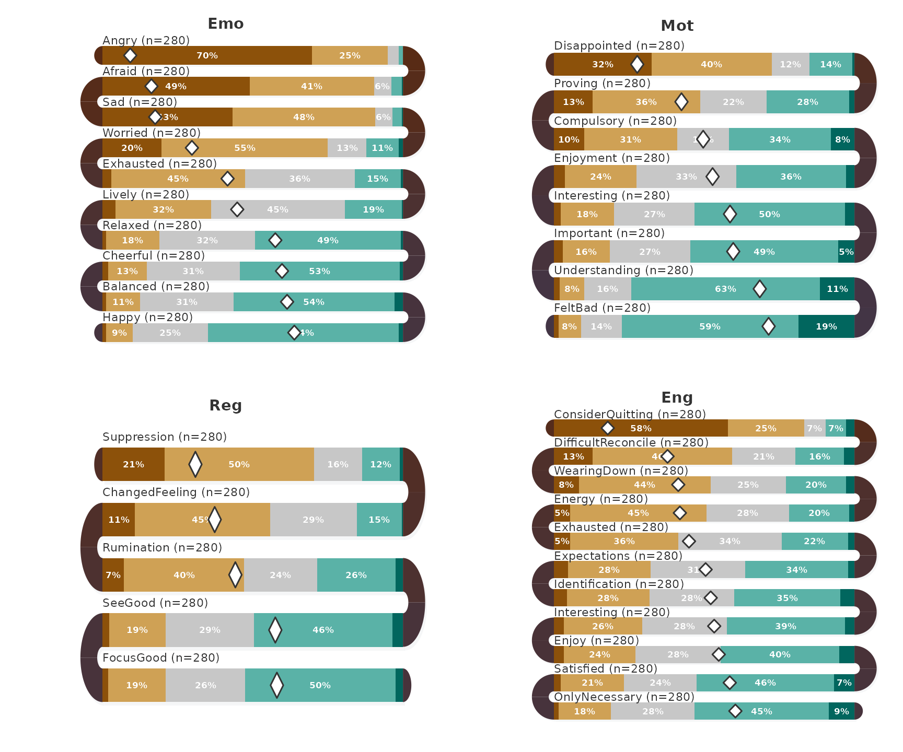
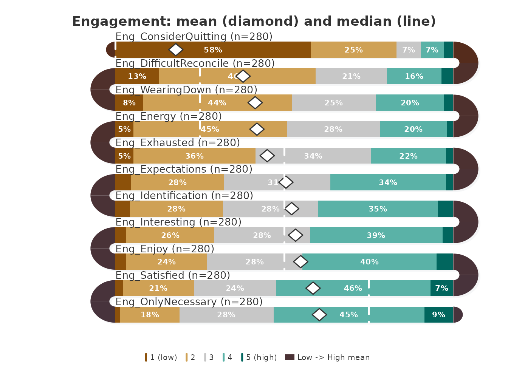
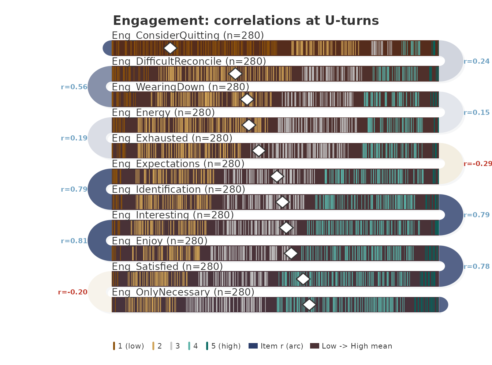

# Case study: a multi-construct student survey

A survey that measures several constructs with several items each poses
two questions at once: how the respondents answered each item, and how
the items relate to the construct they are meant to measure. The usual
displays answer one question at a time. A stacked bar chart of 34 items
shows the response distributions but not which items belong together or
move together; a correlation matrix shows the associations but not the
distributions. A snake plot with one panel per construct keeps the items
of a construct together, orders them by their level of endorsement, and
can print the correlation between neighbouring items at the U-turn that
joins them.

This case study describes a 34-item student survey with four constructs.
It first gives an overview of all constructs, then asks which engagement
items are most and least endorsed and whether the ordering criterion
matters, where the mean and the median of an item part ways, and which
engagement items vary together across students. The plots are drawn with
[`survey_snake()`](https://pak.dynasite.org/Snakeplot/reference/survey_snake.md);
the numbers behind them are computed alongside.

``` r

library(snakeplot)
```

## Data

`student_survey` holds the person-level scores of 280 university
students from an experience sampling study (Neubauer & Schmiedek, 2024;
data CC-BY 4.0 at <https://osf.io/bhq3p>). Each score is the student’s
mean over the study, rounded to a 1–5 scale (rescaled from the original
1–7). The column names carry the construct as a prefix:

- **Respondent:** one row per student.
- **Emotions:** `Emo_` — 10 items, such as `Emo_Happy` and
  `Emo_Worried`.
- **Study motivation:** `Mot_` — 8 items, such as `Mot_Interesting` and
  `Mot_Compulsory`.
- **Emotion regulation:** `Reg_` — 5 items, such as `Reg_Rumination` and
  `Reg_Suppression`.
- **Study engagement:** `Eng_` — 11 items, such as `Eng_Enjoy` and
  `Eng_ConsiderQuitting`.

``` r

dim(student_survey)
#> [1] 280  34
table(construct = sub("_.*", "", names(student_survey)))
#> construct
#> Emo Eng Mot Reg 
#>  10  11   8   5
scale_labels <- c("1" = "1 (low)", "2" = "2", "3" = "3", "4" = "4",
                  "5" = "5 (high)")
```

The data hold 280 students and 34 items: 10 emotion, 11 engagement, 8
motivation and 5 regulation items. The items are named by their content
(for example `Eng_ConsiderQuitting`); the wording of each item is in the
original study’s codebook, so the interpretation below stays with the
item names.

The summary table below gives, for every item, its construct, mean,
median and net score (the share of responses above the scale midpoint of
3 minus the share below it). It is the numerical counterpart of the
plots that follow.

``` r

item_summary <- data.frame(
  construct = sub("_.*", "", names(student_survey)),
  item      = sub("^(Emo|Mot|Reg|Eng)_", "", names(student_survey)),
  mean      = colMeans(student_survey),
  median    = vapply(student_survey, median, numeric(1)),
  net       = colMeans(student_survey > 3) - colMeans(student_survey < 3),
  row.names = NULL
)
sort_by(item_summary, ~ construct + mean)
#>    construct               item mean median      net
#> 9        Emo              Angry 1.37      1 -0.93571
#> 2        Emo             Afraid 1.65      2 -0.86429
#> 3        Emo                Sad 1.70      2 -0.87143
#> 7        Emo            Worried 2.19      2 -0.62857
#> 5        Emo          Exhausted 2.66      3 -0.31429
#> 8        Emo             Lively 2.79      3 -0.16786
#> 10       Emo            Relaxed 3.30      3  0.30357
#> 6        Emo           Cheerful 3.39      4  0.39643
#> 4        Emo           Balanced 3.46      4  0.43929
#> 1        Emo              Happy 3.55      4  0.55000
#> 34       Eng   ConsiderQuitting 1.71      1 -0.73571
#> 27       Eng DifficultReconcile 2.51      2 -0.39643
#> 25       Eng        WearingDown 2.65      2 -0.29286
#> 31       Eng             Energy 2.67      2 -0.28929
#> 29       Eng          Exhausted 2.80      3 -0.17143
#> 33       Eng       Expectations 3.02      3  0.04286
#> 32       Eng     Identification 3.09      3  0.08214
#> 28       Eng        Interesting 3.13      3  0.13214
#> 24       Eng              Enjoy 3.19      3  0.17500
#> 26       Eng          Satisfied 3.34      4  0.29286
#> 30       Eng      OnlyNecessary 3.41      4  0.34286
#> 11       Mot       Disappointed 2.11      2 -0.57500
#> 16       Mot            Proving 2.70      3 -0.19286
#> 15       Mot         Compulsory 2.99      3  0.00714
#> 18       Mot          Enjoyment 3.11      3  0.11786
#> 14       Mot        Interesting 3.34      4  0.33214
#> 13       Mot          Important 3.39      4  0.36071
#> 17       Mot      Understanding 3.74      4  0.64286
#> 12       Mot            FeltBad 3.86      4  0.68571
#> 21       Reg        Suppression 2.24      2 -0.56786
#> 22       Reg     ChangedFeeling 2.49      2 -0.40357
#> 23       Reg         Rumination 2.77      3 -0.18571
#> 19       Reg            SeeGood 3.30      3  0.28571
#> 20       Reg          FocusGood 3.32      4  0.31429
```

## An overview of the four constructs

The first question is how the four constructs compare: which have items
with high endorsement, and how spread out are the item means within a
construct? The range of item means per construct:

``` r

aggregate(mean ~ construct, data = item_summary, FUN = range)
#>   construct mean.1 mean.2
#> 1       Emo   1.37   3.55
#> 2       Eng   1.71   3.41
#> 3       Mot   2.11   3.86
#> 4       Reg   2.24   3.32
```

The emotion items have the widest range of means, from 1.37 (`Angry`) to
3.55 (`Happy`): the construct mixes rarely felt negative emotions with
commonly felt positive ones. The motivation items range from 2.11 to
3.86 and the engagement items from 1.71 to 3.41. The regulation items
have the narrowest range, from 2.24 to 3.32.

With `facet = TRUE`,
[`survey_snake()`](https://pak.dynasite.org/Snakeplot/reference/survey_snake.md)
groups the columns by the prefix before the underscore, draws one panel
per group, and removes the prefix from the item labels.
`sort_by = "mean"` orders the items of each panel by ascending mean, so
every panel runs from its least to its most endorsed item.

``` r

survey_snake(student_survey, facet = TRUE, facet_ncol = 2L,
             tick_shape = "bar", sort_by = "mean",
             colors = snake_palette("earth", n = 5),
             level_labels = scale_labels)
```



Each band is one item, drawn as a stacked bar of the percentage of
students at each level, with the percentage written in segments wide
enough to hold it; the diamond marks the item mean. The first band of
each panel is the item with the lowest mean in the table above (`Angry`,
`Disappointed`, `Suppression`, `ConsiderQuitting`) and the last band the
item with the highest (`Happy`, `FeltBad`, `FocusGood`,
`OnlyNecessary`).

## Which engagement items are endorsed most and least?

The engagement construct has the most items (11), and the following
questions use it. The items sorted by mean, with the net score
alongside:

``` r

engagement <- subset(student_survey, select = Eng_Enjoy:Eng_ConsiderQuitting)
sort_by(subset(item_summary, construct == "Eng"), ~ mean)
#>    construct               item mean median     net
#> 34       Eng   ConsiderQuitting 1.71      1 -0.7357
#> 27       Eng DifficultReconcile 2.51      2 -0.3964
#> 25       Eng        WearingDown 2.65      2 -0.2929
#> 31       Eng             Energy 2.67      2 -0.2893
#> 29       Eng          Exhausted 2.80      3 -0.1714
#> 33       Eng       Expectations 3.02      3  0.0429
#> 32       Eng     Identification 3.09      3  0.0821
#> 28       Eng        Interesting 3.13      3  0.1321
#> 24       Eng              Enjoy 3.19      3  0.1750
#> 26       Eng          Satisfied 3.34      4  0.2929
#> 30       Eng      OnlyNecessary 3.41      4  0.3429
```

`ConsiderQuitting` has by far the lowest mean (1.71) and net score
(−0.736): far more students are below the midpoint than above it.
`DifficultReconcile` (2.51), `WearingDown` (2.65) and `Energy` (2.67)
follow. At the top are `OnlyNecessary` (3.41), `Satisfied` (3.34) and
`Enjoy` (3.19). The net score increases in the same order as the mean,
so for these items `sort_by = "net"` and `sort_by = "mean"` produce the
same bands; the closest pair, `WearingDown` and `Energy`, differs by
0.004 in net score (−0.293 against −0.289). The two criteria can only
disagree for items whose means are close, as the emotion items `Afraid`
and `Sad` do in [the palettes and layout
guide](https://pak.dynasite.org/Snakeplot/articles/palettes-and-layout.md).

## Where do the mean and the median part ways?

An item mean is a fair summary of a symmetric distribution but not of a
skewed one. The question is which items have a median at least half a
scale point away from their mean:

``` r

subset(item_summary, abs(mean - median) >= 0.5)
#>    construct               item mean median    net
#> 4        Emo           Balanced 3.46      4  0.439
#> 6        Emo           Cheerful 3.39      4  0.396
#> 13       Mot          Important 3.39      4  0.361
#> 14       Mot        Interesting 3.34      4  0.332
#> 20       Reg          FocusGood 3.32      4  0.314
#> 25       Eng        WearingDown 2.65      2 -0.293
#> 26       Eng          Satisfied 3.34      4  0.293
#> 27       Eng DifficultReconcile 2.51      2 -0.396
#> 30       Eng      OnlyNecessary 3.41      4  0.343
#> 31       Eng             Energy 2.67      2 -0.289
#> 34       Eng   ConsiderQuitting 1.71      1 -0.736
```

Eleven items meet the criterion. In seven of them the median of 4 lies
above the mean (for example `Satisfied`, mean 3.34, and `OnlyNecessary`,
mean 3.41): the typical student answers 4, and the mean is pulled down
by students at the lower levels. In the other four, all engagement
items, the median lies below the mean: `DifficultReconcile`,
`WearingDown` and `Energy` have a median of 2 and means between 2.51 and
2.67, and `ConsiderQuitting` has a median of 1 and a mean of 1.71. For
these items the typical student is at the low end and the mean is pulled
up by a minority at the higher levels. Six of the eleven items belong to
the engagement construct.

`show_median = TRUE` adds a vertical line at the item median to the mean
diamond. On the engagement items:

``` r

survey_snake(engagement, tick_shape = "bar", sort_by = "mean",
             show_mean = TRUE, show_median = TRUE,
             colors = snake_palette("earth", n = 5),
             level_labels = scale_labels,
             title = "Engagement: mean (diamond) and median (line)")
```



The diamond marks the mean and the dashed line the median of each item.
Both markers are placed on the response scale, which runs from level 1
at the left end of the band to level 5 at the right end, so one scale
point is a quarter of the band width; they are not tied to the stacked
segments, whose widths are percentages. The horizontal distance between
the two markers is therefore the difference between mean and median:
0.71 scale points for `ConsiderQuitting`, between 0.5 and 0.7 for the
other five engagement items in the table above, and less than half a
point for the remaining five. A reader who sees only the diamond on
`ConsiderQuitting` would place the typical student between levels 1 and
2; the median places that student at level 1.

## Which engagement items vary together?

The last question concerns associations: do students who endorse one
engagement item also endorse its neighbour? `arc_fill = "correlation"`
computes the Pearson correlation between each pair of adjacent items
across the students who answered both, prints it at the U-turn that
joins them, and tints the arc by its sign (`arc_color` for positive, its
complement for negative) and strength. Because the correlation pairs
each student’s answer to one item with the same student’s answer to the
next, it needs the raw responses, one row per student;
[`survey_snake()`](https://pak.dynasite.org/Snakeplot/reference/survey_snake.md)
refuses a table of counts for this fill. The plot returns its layout
invisibly, and the correlations it printed are returned by
[`as.data.frame()`](https://rdrr.io/r/base/as.data.frame.html) with
`what = "correlations"`.

``` r

engagement_layout <- survey_snake(engagement, tick_shape = "line",
                                  arc_fill = "correlation", sort_by = "mean",
                                  colors = snake_palette("earth", n = 5),
                                  level_labels = scale_labels,
                                  title = "Engagement: correlations at U-turns")
```



``` r

as.data.frame(engagement_layout, what = "correlations")
#>                      from                     to      r   n
#> 1    Eng_ConsiderQuitting Eng_DifficultReconcile  0.237 280
#> 2  Eng_DifficultReconcile        Eng_WearingDown  0.562 280
#> 3         Eng_WearingDown             Eng_Energy  0.153 280
#> 4              Eng_Energy          Eng_Exhausted  0.194 280
#> 5           Eng_Exhausted       Eng_Expectations -0.293 280
#> 6        Eng_Expectations     Eng_Identification  0.787 280
#> 7      Eng_Identification        Eng_Interesting  0.786 280
#> 8         Eng_Interesting              Eng_Enjoy  0.808 280
#> 9               Eng_Enjoy          Eng_Satisfied  0.780 280
#> 10          Eng_Satisfied      Eng_OnlyNecessary -0.205 280
```

Each band is one item, sorted by mean, with one tick per student in the
zone of the student’s response level; the number at each U-turn is the
correlation `r` between the two items it joins, computed over `n`
students. All ten correlations use the 280 students. The upper half of
the order forms a strongly correlated chain: `Expectations`,
`Identification`, `Interesting`, `Enjoy` and `Satisfied` correlate
between 0.78 and 0.81 with their neighbours. Two U-turns carry negative
correlations, `Exhausted` with `Expectations` (−0.293) and `Satisfied`
with `OnlyNecessary` (−0.205), and the arcs there take the complementary
tint. The weakest positive links are `WearingDown` with `Energy` (0.153)
and `Energy` with `Exhausted` (0.194).

The arcs report only adjacent pairs, and the order by mean is not chosen
to place related items next to each other. `WearingDown` and `Exhausted`
are separated by `Energy` in this order; their correlation, computed
directly:

``` r

with(student_survey, cor(Eng_WearingDown, Eng_Exhausted))
#> [1] 0.72
```

At 0.72 it is far stronger than either of their correlations with
`Energy`, which sits between them only because its mean (2.67) falls
between theirs (2.65 and 2.80). A weak arc therefore means that two
neighbouring items are weakly related, not that an item is unrelated to
the rest of its construct.

## Conclusions

- The four constructs differ in spread: emotion item means range from
  1.37 to 3.55, regulation item means only from 2.24 to 3.32.
- `ConsiderQuitting` is the least endorsed engagement item (mean 1.71,
  net score −0.736); `OnlyNecessary` and `Satisfied` are the most
  endorsed.
- For the engagement items, sorting by mean and by net score gives the
  same order.
- Eleven of the 34 items have a median at least half a point from the
  mean; in seven the median is higher, in four engagement items, among
  them `ConsiderQuitting`, it is lower. `show_median = TRUE` draws the
  gap in the plot.
- The engagement items `Expectations`, `Identification`, `Interesting`,
  `Enjoy` and `Satisfied` form a chain of correlations between 0.78 and
  0.81; `Exhausted`–`Expectations` and `Satisfied`–`OnlyNecessary` are
  negatively correlated. Correlation arcs show only neighbours in the
  chosen order, so a weak arc calls for a direct check, as for
  `WearingDown` and `Exhausted` (r = 0.72).

The daily, beep-level counterpart of the emotion items is analysed in
[the daily emotions case
study](https://pak.dynasite.org/Snakeplot/articles/case-daily-emotions.md);
colour and ordering choices are discussed in [the palettes and layout
guide](https://pak.dynasite.org/Snakeplot/articles/palettes-and-layout.md).

## Reference

Neubauer, A. B., & Schmiedek, F. (2024). Approaching academic adjustment
on multiple time scales. *Zeitschrift für Erziehungswissenschaft,
27*(1), 147–168. <https://doi.org/10.1007/s11618-023-01182-8>
