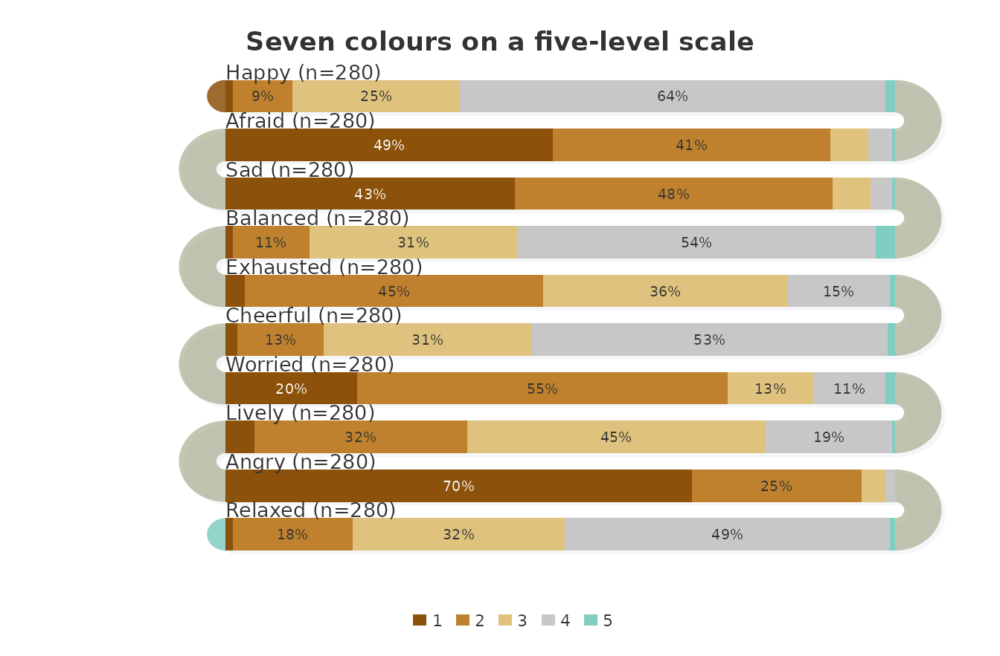
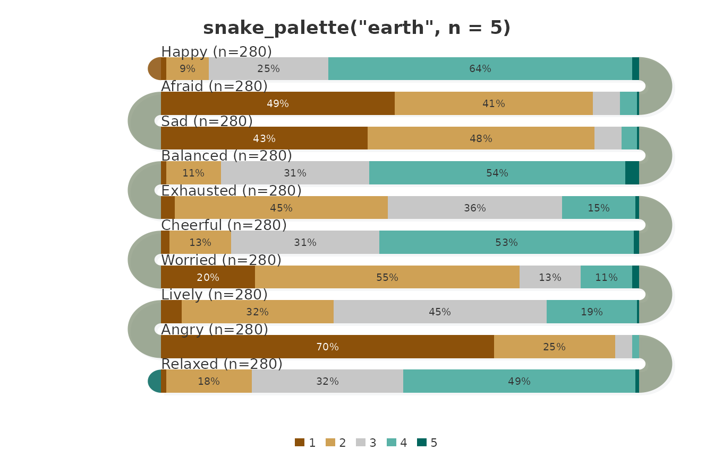
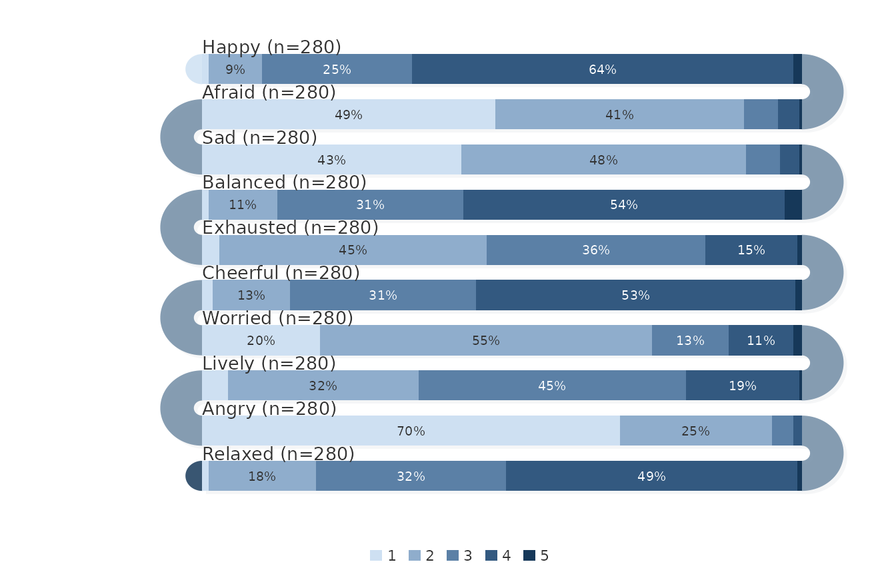
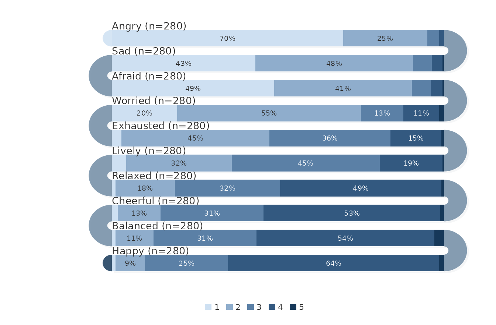
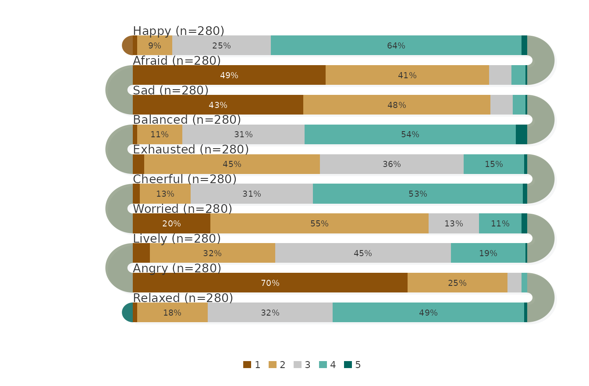
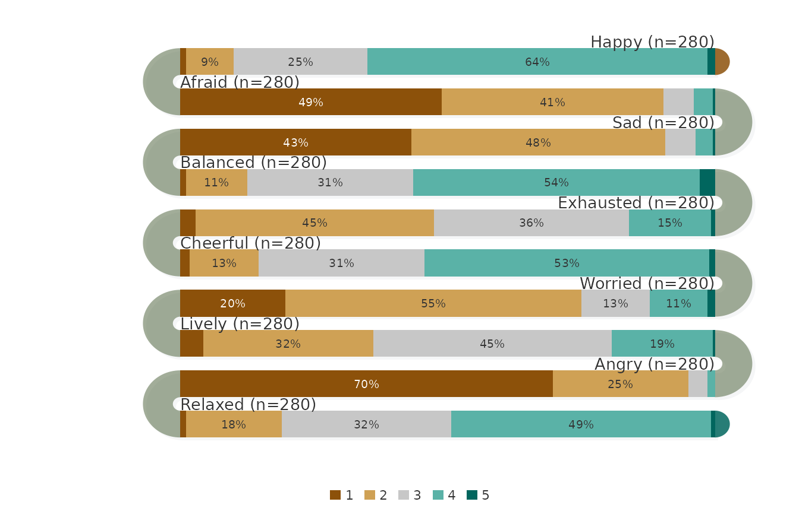
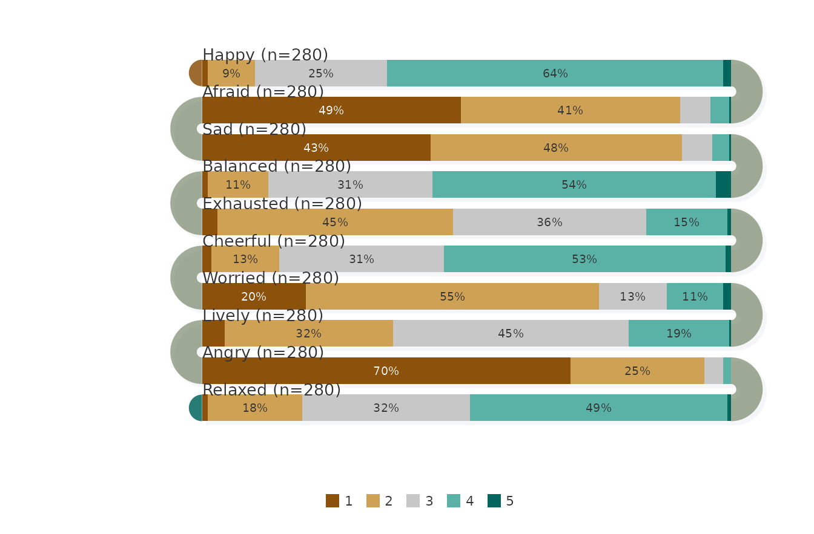

# Palettes, reading order and layout

A snake plot makes three kinds of design decision on the reader’s
behalf. The colour scale decides whether a response scale is read as two
opposing sides around a neutral midpoint or as a single ordered
intensity. The reading order decides in which direction each band is
read and on which side the first band starts. The geometry (band height,
gap and width) decides the aspect ratio of the figure and how much of
the page it takes. Each decision has a default, and each default is
wrong for some data.

This guide covers the built-in palettes
([`snake_palette()`](https://pak.dynasite.org/Snakeplot/reference/snake_palette.md),
`snake_palettes`), how many colours a plot uses, the difference between
[`survey_sequence()`](https://pak.dynasite.org/Snakeplot/reference/survey_sequence.md)
and
[`sequential_dist()`](https://pak.dynasite.org/Snakeplot/reference/sequential_dist.md),
the ordering of items (`sort_by`), the reading order (`flow`,
`start_from`), the label position (`label_align`), and the geometry
(`band_height`, `band_gap`, `plot_width`). Reading order for
time-ordered data is also shown in [the sequences
guide](https://pak.dynasite.org/Snakeplot/articles/sequences.md) and
[the activity
guide](https://pak.dynasite.org/Snakeplot/articles/activity.md).

``` r

library(snakeplot)
```

## Data

`ema_emotions` holds the person-level emotion ratings of the students in
an experience sampling study (Neubauer & Schmiedek, 2024; data CC-BY 4.0
at <https://osf.io/bhq3p>): each student’s mean rating of each emotion
over the study, rounded to the 1–5 scale.

- **Respondent:** one row per student.
- **Items:** `Happy`, `Afraid`, `Sad`, `Balanced`, `Exhausted`,
  `Cheerful`, `Worried`, `Lively`, `Angry`, `Relaxed` — how strongly the
  emotion was felt, 1 (not at all) to 5 (extremely).

``` r

dim(ema_emotions)
#> [1] 280  10
head(ema_emotions)
#>   Happy Afraid Sad Balanced Exhausted Cheerful Worried Lively Angry Relaxed
#> 1     4      2   2        4         3        3       3      3     1       4
#> 2     4      1   2        3         4        4       2      3     1       3
#> 3     3      1   2        4         4        3       2      2     1       4
#> 4     4      1   1        3         3        4       2      2     1       3
#> 5     4      2   2        4         2        4       2      3     2       3
#> 6     2      2   2        3         2        2       2      2     2       3
```

The data hold 280 respondents and 10 items. The legends below show the
response levels as the numbers 1 to 5.

## The built-in palettes

`snake_palettes` is a named list of ten palettes of seven anchor colours
each;
[`snake_palette()`](https://pak.dynasite.org/Snakeplot/reference/snake_palette.md)
returns one of them interpolated to `n` colours.

``` r

names(snake_palettes)
#>  [1] "classic" "earth"   "ocean"   "sunset"  "berry"   "blues"   "greens"  "grays"  
#>  [9] "warm"    "viridis"
snake_palette("earth", n = 5)
#> [1] "#8C510A" "#CFA155" "#C7C7C7" "#5AB2A7" "#01665E"
snake_palette("blues", n = 5)
#> [1] "#EFF3FF" "#B2D2E8" "#6BAED6" "#3181BD" "#084594"
```

The five-colour `earth` palette runs from brown through a grey midpoint
(`#C7C7C7`) to teal: a diverging palette. The five-colour `blues`
palette runs from near-white to dark blue: a sequential palette. The
difference can be measured rather than judged by eye. The CIE L\*
lightness of a colour runs from 0 (black) to 100 (white); the next chunk
converts every palette, interpolated to five colours, to L\* with
[`grDevices::convertColor()`](https://rdrr.io/r/grDevices/convertColor.html)
and tabulates it by palette and level.

``` r

swatches <- data.frame(
  palette = rep(names(snake_palettes), each = 5),
  level   = rep(seq_len(5), times = length(snake_palettes)),
  colour  = unlist(lapply(names(snake_palettes), snake_palette, n = 5))
)
lab <- with(swatches, convertColor(t(col2rgb(colour)) / 255,
                                   from = "sRGB", to = "Lab"))
swatches <- cbind(swatches, round(lab))
xtabs(L ~ palette + level, data = swatches)
#>          level
#> palette    1  2  3  4  5
#>   berry   45 71 85 77 54
#>   blues   96 83 68 52 30
#>   classic 39 65 84 67 42
#>   earth   40 69 80 67 38
#>   grays   97 82 62 42 15
#>   greens  96 85 73 57 33
#>   ocean   48 69 89 76 49
#>   sunset  48 71 86 61 27
#>   viridis 91 77 64 49 36
#>   warm    97 82 70 56 33
```

Two families are visible in the table. In `berry`, `classic`, `earth`,
`ocean` and `sunset` the lightness rises from level 1 to the grey level
3 (L\* 80 to 89) and falls again towards level 5: the two ends are dark
and the middle is light, so distance from the midpoint is carried by
lightness and the side of the midpoint by hue. In `blues`, `grays`,
`greens`, `viridis` and `warm` the lightness falls monotonically from
level 1 (L\* 91 to 97) to level 5 (L\* 15 to 36), so the order of the
levels is carried by lightness alone. The arms of the diverging palettes
are not all balanced: in `sunset` level 1 has L\* 48 and level 5 has L\*
27, so the high end is darker than the low end, whereas `earth` (40
against 38), `classic` (39 against 42) and `ocean` (48 against 49) are
close to symmetric. This guide makes no claim about how any palette
appears to readers with a colour-vision deficiency; that would require a
simulation that is not shown here.

## Pass the number of levels

[`survey_snake()`](https://pak.dynasite.org/Snakeplot/reference/survey_snake.md),
[`survey_sequence()`](https://pak.dynasite.org/Snakeplot/reference/survey_sequence.md)
and
[`sequential_dist()`](https://pak.dynasite.org/Snakeplot/reference/sequential_dist.md)
use only the first `length(levels)` colours of `colors`.
[`snake_palette()`](https://pak.dynasite.org/Snakeplot/reference/snake_palette.md)
returns seven colours by default, so a five-level scale given the
default palette uses the first five of them.

``` r

snake_palette("earth")
#> [1] "#8C510A" "#BF812D" "#DFC27D" "#C7C7C7" "#80CDC1" "#35978F" "#01665E"
head(snake_palette("earth"), 5)
#> [1] "#8C510A" "#BF812D" "#DFC27D" "#C7C7C7" "#80CDC1"
snake_palette("earth", n = 5)
#> [1] "#8C510A" "#CFA155" "#C7C7C7" "#5AB2A7" "#01665E"
```

The first five of the seven `earth` colours end with the grey midpoint
`#C7C7C7` at position 4 and the light teal `#80CDC1` at position 5: on a
five-level scale the neutral colour would be assigned to level 4
(*quite*) and the darkest teal would never be used. With `n = 5` the
grey is at position 3, the midpoint of the scale, and both ends are the
darkest colours.

``` r

survey_sequence(ema_emotions,
                colors = snake_palette("earth"),
                title = "Seven colours on a five-level scale")
```



``` r

survey_sequence(ema_emotions,
                colors = snake_palette("earth", n = 5),
                title = "snake_palette(\"earth\", n = 5)")
```



The two plots draw the same counts; only the colour assigned to each
level differs. In the first, level 3 is drawn in the light sand colour
and level 4 in grey; in the second, level 3 is grey and the scale is
symmetric around it.

## Scales with and without a neutral midpoint

A diverging palette states that the middle level is neutral and that the
two ends are opposites. That is true of an agreement scale (disagree,
neutral, agree) but not of an intensity scale: rating anger as
*Moderately* is not a neutral point between two kinds of anger, but more
anger than *Slightly*. The emotion items are intensity ratings. The
share of respondents at each level of each item:

``` r

round(100 * prop.table(xtabs(~ ind + values, data = stack(ema_emotions)),
                       margin = 1))
#>            values
#> ind          1  2  3  4  5
#>   Happy      1  9 25 64  1
#>   Afraid    49 41  6  4  0
#>   Sad       43 48  6  3  0
#>   Balanced   1 11 31 54  3
#>   Exhausted  3 45 36 15  1
#>   Cheerful   2 13 31 53  1
#>   Worried   20 55 13 11  1
#>   Lively     4 32 45 19  0
#>   Angry     70 25  4  1  0
#>   Relaxed    1 18 32 49  1
```

The negative emotions are concentrated at the bottom of the scale: 70%
of the respondents rated `Angry` at level 1 and 1% above level 3, and
`Afraid` and `Sad` have 49% and 43% at level 1. The positive emotions
are concentrated at level 4 (64% for `Happy`, 53% for `Cheerful`, 54%
for `Balanced`). For such a scale,
[`sequential_dist()`](https://pak.dynasite.org/Snakeplot/reference/sequential_dist.md)
draws the same stacked bars as
[`survey_sequence()`](https://pak.dynasite.org/Snakeplot/reference/survey_sequence.md)
with a single-hue ramp, so a darker segment means a stronger emotion.

``` r

sequential_dist(ema_emotions)
```



The default ramp is a blue (`hue = 210`); `hue` selects another hue, and
`colors` accepts any five colours, for example
`snake_palette("greens", n = 5)`.
[`survey_sequence()`](https://pak.dynasite.org/Snakeplot/reference/survey_sequence.md)
with a diverging palette is the right choice for agreement scales and
other bipolar scales;
[`sequential_dist()`](https://pak.dynasite.org/Snakeplot/reference/sequential_dist.md)
for intensity and frequency scales.

## Ordering the items

The input order of the items is rarely the order in which a reader wants
to compare them. `sort_by = "mean"` orders the bands by ascending item
mean; `sort_by = "net"` by the share of responses above the scale
midpoint minus the share below it. Both scores, computed directly and
sorted with base R’s [`sort_by()`](https://rdrr.io/r/base/sort_by.html):

``` r

item_scores <- data.frame(
  item = names(ema_emotions),
  mean = colMeans(ema_emotions),
  net  = colMeans(ema_emotions > 3) - colMeans(ema_emotions < 3)
)
sort_by(item_scores, ~ mean)
#>                item mean    net
#> Angry         Angry 1.37 -0.936
#> Afraid       Afraid 1.65 -0.864
#> Sad             Sad 1.70 -0.871
#> Worried     Worried 2.19 -0.629
#> Exhausted Exhausted 2.66 -0.314
#> Lively       Lively 2.79 -0.168
#> Relaxed     Relaxed 3.30  0.304
#> Cheerful   Cheerful 3.39  0.396
#> Balanced   Balanced 3.46  0.439
#> Happy         Happy 3.55  0.550
sort_by(item_scores, ~ net)
#>                item mean    net
#> Angry         Angry 1.37 -0.936
#> Sad             Sad 1.70 -0.871
#> Afraid       Afraid 1.65 -0.864
#> Worried     Worried 2.19 -0.629
#> Exhausted Exhausted 2.66 -0.314
#> Lively       Lively 2.79 -0.168
#> Relaxed     Relaxed 3.30  0.304
#> Cheerful   Cheerful 3.39  0.396
#> Balanced   Balanced 3.46  0.439
#> Happy         Happy 3.55  0.550
```

The two orders agree except for one pair: by mean, `Afraid` (1.65) comes
before `Sad` (1.70); by net score, `Sad` (−0.871) comes before `Afraid`
(−0.864). The mean uses every level, the net score only whether a
response lies above or below the midpoint; they diverge when two items
have similar means but differ in how many responses sit exactly at the
midpoint.

``` r

sequential_dist(ema_emotions, sort_by = "net")
```



The bands now run from `Angry`, the item with the lowest net score, to
`Happy`, the item with the highest.

## Reading order: flow and start_from

`flow = "snake"` (the default of the survey functions) alternates the
direction of the bands, as in a boustrophedon; `flow = "natural"` reads
every band in the same direction. `start_from` decides on which side the
first band begins. The survey functions return their layout invisibly,
and [`as.data.frame()`](https://rdrr.io/r/base/as.data.frame.html) gives
its `bands` table, which records the geometry of each band: `direction`
is the side the path enters from (which always alternates, because the
arcs alternate), and `read_direction` is the direction in which the
content of the band is read.

``` r

natural <- survey_sequence(ema_emotions,
                           colors = snake_palette("earth", n = 5),
                           flow = "natural", label_align = "left")
```



``` r

subset(as.data.frame(natural), select = c(i, direction, read_direction))
#>    i direction read_direction
#> 1  0       ltr            ltr
#> 2  1       rtl            ltr
#> 3  2       ltr            ltr
#> 4  3       rtl            ltr
#> 5  4       ltr            ltr
#> 6  5       rtl            ltr
#> 7  6       ltr            ltr
#> 8  7       rtl            ltr
#> 9  8       ltr            ltr
#> 10 9       rtl            ltr
```

With `flow = "natural"` the `direction` column alternates between `ltr`
and `rtl` while `read_direction` is `ltr` for all ten bands.

``` r

mirrored <- survey_sequence(ema_emotions,
                            colors = snake_palette("earth", n = 5),
                            start_from = "right", label_align = "direction")
```



``` r

subset(as.data.frame(mirrored), select = c(i, direction, read_direction))
#>    i direction read_direction
#> 1  0       rtl            rtl
#> 2  1       ltr            ltr
#> 3  2       rtl            rtl
#> 4  3       ltr            ltr
#> 5  4       rtl            rtl
#> 6  5       ltr            ltr
#> 7  6       rtl            rtl
#> 8  7       ltr            ltr
#> 9  8       rtl            rtl
#> 10 9       ltr            ltr
```

With the default `flow = "snake"` and `start_from = "right"`, the first
band is read from right to left (`rtl`) and the reading direction
alternates with the path. `label_align = "direction"` places each item
label on the side where its band begins to be read, whereas `"left"`
(the default) and `"right"` place all labels on one side. In survey
plots each band is an item, and the segments within a band follow the
order of the scale, not of time, so the response levels are drawn from
left to right in every band; `reverse_rtl = TRUE` mirrors them on
right-to-left bands. When the content of a band is ordered in time, as
in
[`sequence_snake()`](https://pak.dynasite.org/Snakeplot/reference/sequence_snake.md)
or
[`activity_snake()`](https://pak.dynasite.org/Snakeplot/reference/activity_snake.md),
the reading direction changes what the reader sees; see [the sequences
guide](https://pak.dynasite.org/Snakeplot/articles/sequences.md).

## Geometry and figure size

All geometry is in plot units: `band_height` is the height of a band,
`band_gap` the white space between bands and `plot_width` the length of
a band. The canvas grows with all three;
[`as.data.frame()`](https://rdrr.io/r/base/as.data.frame.html) with
`what = "canvas"` gives its size.

``` r

default_layout <- survey_sequence(ema_emotions,
                                  colors = snake_palette("earth", n = 5))
```


``` r

as.data.frame(default_layout, what = "canvas")
#>   width height
#> 1   692    506
compact_layout <- survey_sequence(ema_emotions,
                                  colors = snake_palette("earth", n = 5),
                                  band_height = 20, band_gap = 8,
                                  plot_width = 400)
```



``` r

as.data.frame(compact_layout, what = "canvas")
#>   width height
#> 1   570    372
```

The default layout of the ten items is 692 by 506 units, an aspect ratio
of about 1.37; the compact layout is 570 by 372 units, about 1.53. The
canvas is scaled to the graphics device, so the ratio of `fig.width` to
`fig.height` should be close to the ratio of the canvas width to its
height; otherwise white space appears on two sides of the plot. Thinner
bands and narrower gaps are the way to keep a plot of many items from
becoming tall: here they reduce the height by 134 units, about a
quarter.

## Summary

- Pass `n` equal to the number of response levels to
  [`snake_palette()`](https://pak.dynasite.org/Snakeplot/reference/snake_palette.md);
  the survey functions use only the first `length(levels)` colours.
- Use a diverging palette with
  [`survey_snake()`](https://pak.dynasite.org/Snakeplot/reference/survey_snake.md)
  or
  [`survey_sequence()`](https://pak.dynasite.org/Snakeplot/reference/survey_sequence.md)
  for bipolar scales with a neutral midpoint, and
  [`sequential_dist()`](https://pak.dynasite.org/Snakeplot/reference/sequential_dist.md)
  or a sequential palette for intensity and frequency scales.
- Order items with `sort_by = "mean"` or `"net"`; the two differ only
  where items have close means but different shares at the midpoint.
- `flow = "natural"` reads every band in the same direction;
  `flow = "snake"` alternates; `start_from` selects the side of the
  first band; `label_align = "direction"` follows the reading direction.
- Thinner bands (`band_height`), narrower gaps (`band_gap`) and shorter
  bands (`plot_width`) shrink the canvas; match the figure’s aspect
  ratio to it.

## Reference

Neubauer, A. B., & Schmiedek, F. (2024). Approaching academic adjustment
on multiple time scales. *Zeitschrift für Erziehungswissenschaft,
27*(1), 147–168. <https://doi.org/10.1007/s11618-023-01182-8>
