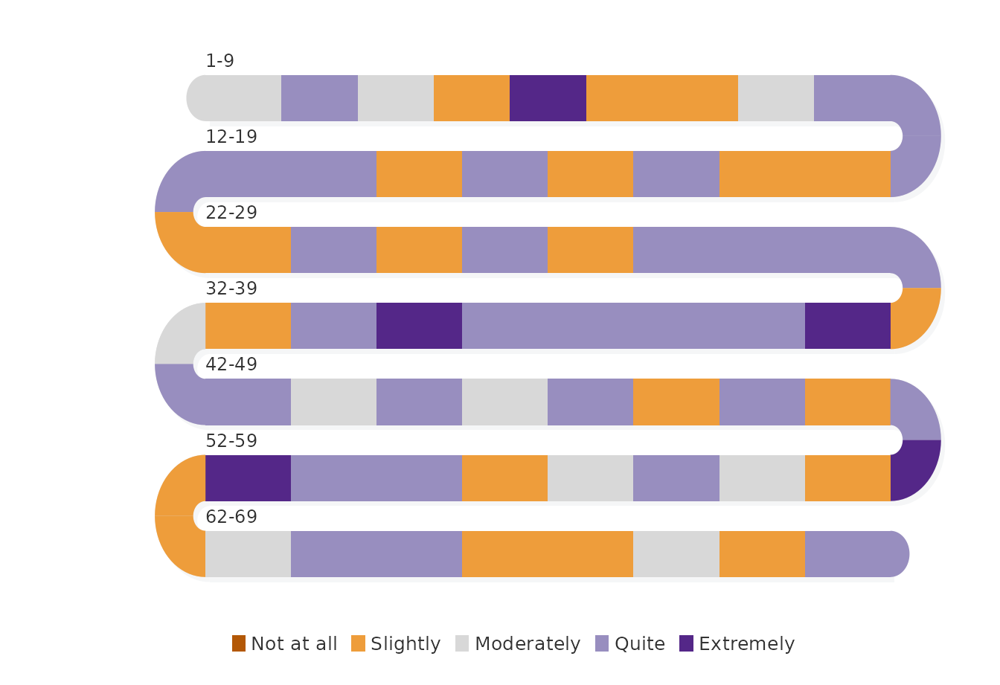
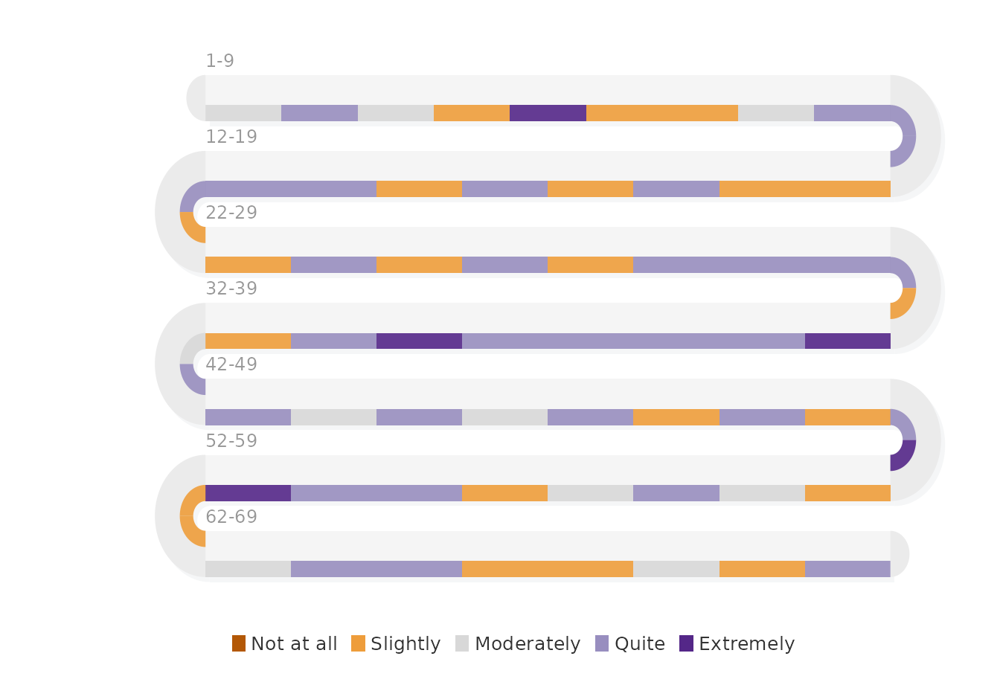
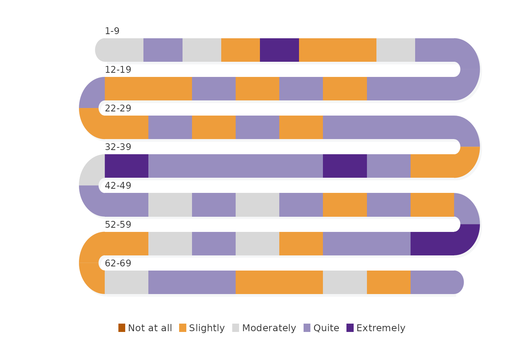
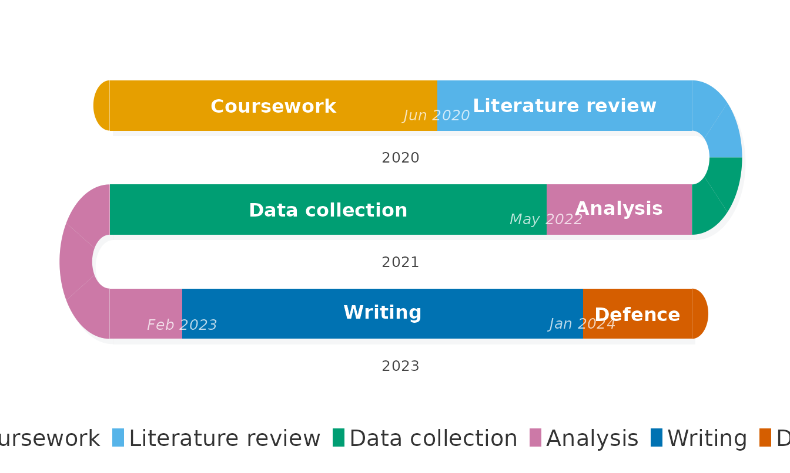
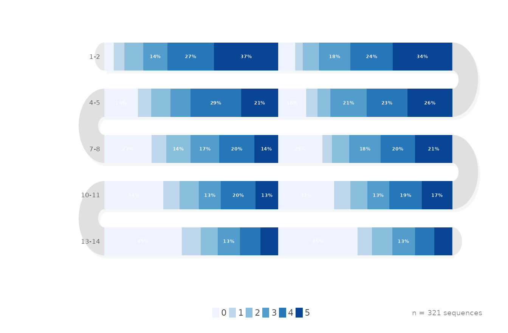
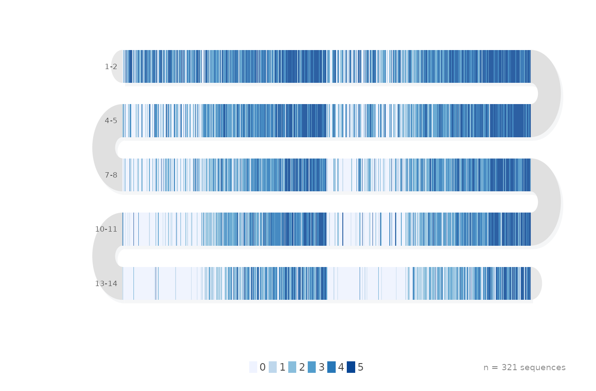

# Categorical sequences and timelines

A categorical sequence records which state a unit occupies at each of
many ordered time points: the rating a participant gives at each prompt
of an experience sampling study, the activity a student performs at each
step of a session, the role a person holds in each month of a career.
Drawn on a single horizontal axis, a sequence of more than a few dozen
positions either becomes too narrow to read or too wide to fit on a
page. A snake plot folds the axis into horizontal bands joined by U-turn
arcs, so a long sequence keeps its order and every position keeps a
readable width.

This guide covers the three functions for categorical sequences.
[`sequence_snake()`](https://pak.dynasite.org/Snakeplot/reference/sequence_snake.md)
draws one sequence position by position, as coloured blocks or as a thin
rug.
[`timeline_snake()`](https://pak.dynasite.org/Snakeplot/reference/timeline_snake.md)
draws a small number of long phases from a table of start and end dates.
[`multi_snake()`](https://pak.dynasite.org/Snakeplot/reference/multi_snake.md)
draws many sequences at once, either one tick per sequence (index mode)
or the share of sequences in each state at each time point (distribution
mode). Continuous and clock-time data are covered in [the activity
guide](https://pak.dynasite.org/Snakeplot/articles/activity.md); colours
and reading order in [the palettes and layout
guide](https://pak.dynasite.org/Snakeplot/articles/palettes-and-layout.md).

``` r

library(snakeplot)
```

## Data

The examples use `ema_beeps`, the beep-level records of an experience
sampling study in which 321 university students rated their emotions on
prompts (“beeps”) sent to their phones over 14 study days (Neubauer &
Schmiedek, 2024; data CC-BY 4.0 at <https://osf.io/bhq3p>). Each row is
one answered beep.

- **Participant:** `id` — anonymised identifier.
- **Study day:** `day` — 1 to 14.
- **Time stamp:** `start_time` — date and clock time of the beep
  (POSIXct).
- **Ratings:** `happy`, `angry` — self-reported happiness and anger on a
  1–5 scale (rescaled from the original 1–7).

``` r

head(ema_beeps)
#>           id day          start_time happy angry
#> 1 rWHXOoWROh   1 2021-04-12 07:05:18     4     1
#> 2 TTlGjDnYES   1 2021-04-12 07:13:21     3     1
#> 3 drLUn8WkiV   1 2021-04-12 07:16:53     2     2
#> 4 FHdZyUVyoX   1 2021-04-12 07:17:46     4     1
#> 5 K484tgXmQw   1 2021-04-12 07:21:18     4     1
#> 6 HbzPYIRcdd   1 2021-04-12 07:23:33     4     1
with(ema_beeps, c(beeps = length(id), participants = length(unique(id)),
                  days = length(unique(day))))
#>        beeps participants         days 
#>        11474          321           14
```

The data hold 11,474 answered beeps from 321 participants over 14 study
days. The ratings are integers; the examples below give them verbal
labels so that the legends read as a response scale.

## One participant’s ratings as a sequence

The first question concerns a single participant: in what order did
participant `xcVDLRQOwn` report each level of happiness, beep after
beep? The ratings are converted to a factor with labelled levels, and
the counts per level and the number of changes between consecutive beeps
are computed.

``` r

scale_labels <- c("Not at all", "Slightly", "Moderately", "Quite", "Extremely")
mood <- transform(subset(ema_beeps, id == "xcVDLRQOwn"),
                  happiness = factor(happy, levels = 1:5, labels = scale_labels))
nrow(mood)
#> [1] 69
with(mood, table(happiness))
#> happiness
#> Not at all   Slightly Moderately      Quite  Extremely 
#>          0         22         10         32          5
with(mood, sum(head(happiness, -1) != tail(happiness, -1)))
#> [1] 47
```

The participant answered 69 beeps. The most frequent rating is *Quite*
(32 beeps), followed by *Slightly* (22), *Moderately* (10) and
*Extremely* (5); *Not at all* never occurs. The rating changes between
47 of the 68 pairs of consecutive beeps, so the sequence is dominated by
short runs rather than long stable spells.

[`sequence_snake()`](https://pak.dynasite.org/Snakeplot/reference/sequence_snake.md)
takes the sequence as a vector, a comma-separated string, or a data
frame whose first character or factor column holds the states. Without
`states`, the states are taken in order of first appearance, not from
the factor levels; passing `states` fixes the legend order to the order
of the scale, and a five-colour palette gives one colour per level.

``` r

sequence_snake(subset(mood, select = happiness),
               states = scale_labels,
               colors = snake_palette("sunset", n = 5))
#> Using column 'happiness' as sequence
```



Each block is one beep, coloured by its rating, in the order in which
the beeps were answered. The blocks continue through the U-turn arcs, so
no position is skipped where one band ends and the next begins; the
label above each band gives the range of beep numbers it holds. Because
47 of 68 consecutive pairs differ, most blocks have a neighbour of a
different colour, which is the visual counterpart of the frequent
changes computed above.

## Block and rug styles

The block style fills the full band height and suits sequences of up to
a few hundred positions. The rug style draws each position as a thin
coloured mark on a light band, which keeps individual positions apart
when the sequence is long or when the eye should follow the positions
rather than the runs.

``` r

sequence_snake(subset(mood, select = happiness),
               states = scale_labels,
               colors = snake_palette("sunset", n = 5),
               style = "rug")
#> Using column 'happiness' as sequence
```



The encoding is the same as in the block version: one mark per beep, in
beep order, coloured by the rating. The rug style also accepts `jitter`,
a vertical scatter of the marks; it is off by default because a
scattered rug reads as a distribution rather than as an ordered
sequence.

## Reading direction

[`sequence_snake()`](https://pak.dynasite.org/Snakeplot/reference/sequence_snake.md)
reads every band from left to right by default (`flow = "natural"`),
like lines of text. With `flow = "snake"` the direction alternates, so
the sequence runs left to right in the first band, right to left in the
second, and so on, and consecutive positions on either side of a U-turn
sit next to each other.

``` r

sequence_snake(subset(mood, select = happiness),
               states = scale_labels,
               colors = snake_palette("sunset", n = 5),
               flow = "snake")
#> Using column 'happiness' as sequence
```



The natural flow is the better default when readers compare the same
position across bands; the alternating flow keeps the path continuous at
the turns. [The palettes and layout
guide](https://pak.dynasite.org/Snakeplot/articles/palettes-and-layout.md)
shows how the reading direction of every band can be checked from the
returned layout.

## Phases with dates

A career, a degree or a project consists of a few long phases, each with
a start and an end date. The question here is how the time of a doctoral
project is divided among its phases. The phases are entered as a small
table, and the length of each phase in months is computed from its
dates.

``` r

phd <- data.frame(
  phase = c("Coursework", "Literature review", "Data collection",
            "Analysis", "Writing", "Defence"),
  start = as.Date(c("2019-09-01", "2020-06-01", "2021-03-01",
                    "2022-05-01", "2023-02-01", "2024-01-01")),
  end   = as.Date(c("2020-05-01", "2021-02-01", "2022-04-01",
                    "2023-01-01", "2023-12-01", "2024-03-01"))
)
phd_months <- transform(phd, months = 12 * (as.integer(format(end, "%Y")) -
                                            as.integer(format(start, "%Y"))) +
                                      as.integer(format(end, "%m")) -
                                      as.integer(format(start, "%m")) + 1)
phd_months
#>               phase      start        end months
#> 1        Coursework 2019-09-01 2020-05-01      9
#> 2 Literature review 2020-06-01 2021-02-01      9
#> 3   Data collection 2021-03-01 2022-04-01     14
#> 4          Analysis 2022-05-01 2023-01-01      9
#> 5           Writing 2023-02-01 2023-12-01     11
#> 6           Defence 2024-01-01 2024-03-01      3
with(phd_months, sum(months))
#> [1] 55
```

The project spans 55 months. Data collection is the longest phase (14
months), writing takes 11, coursework, the literature review and the
analysis take 9 each, and the defence 3.

[`timeline_snake()`](https://pak.dynasite.org/Snakeplot/reference/timeline_snake.md)
takes the three columns (state, start, end), expands them into one block
per month, writes each phase name inside its run, and labels the month
at which each phase ends.

``` r

timeline_snake(phd,
               colors = c("#E69F00", "#56B4E9", "#009E73",
                          "#CC79A7", "#0072B2", "#D55E00"))
```



Each band holds about 20 months, so the 55 months fold into three bands.
The width of a phase is proportional to its length in months, which
places the 14-month data collection and the 3-month defence on the same
scale. The transition labels mark the last month of each phase; the band
labels give the year.

## Many sequences at once

The last question concerns the whole cohort rather than one participant:
how many beeps did each participant answer on each study day, and how
does that change over the 14 days? The number of answered beeps per
participant and day is a categorical state from 0 (no beep answered) to
5 (all beeps answered). The first table holds one row per
participant-day; the second gives, for each day, the percentage of the
321 participants in each state.

``` r

daily <- as.data.frame(xtabs(~ id + day, data = ema_beeps),
                       responseName = "beeps")
head(daily)
#>           id day beeps
#> 1 02mBDOaKrA   1     0
#> 2 0srrQwQTj4   1     4
#> 3 0XzIWrTHyN   1     3
#> 4 17Jua47SqY   1     4
#> 5 1bgMBkQ7SD   1     1
#> 6 1Bt6uXpvV9   1     2
round(100 * prop.table(xtabs(~ day + beeps, data = daily), margin = 1))
#>     beeps
#> day   0  1  2  3  4  5
#>   1   5  6 11 14 27 37
#>   2  10  4  9 18 24 34
#>   3  13  7  7 15 28 30
#>   4  16  7  7 21 23 26
#>   5  19  7 11 12 29 21
#>   6  25  9 16 15 21 15
#>   7  27  8 14 17 20 14
#>   8  25  6 10 18 20 21
#>   9  33  8 12 12 16 19
#>   10 32  9 10 13 19 17
#>   11 34  9 11 13 20 13
#>   12 39  9 10 13 14 14
#>   13 45 11 10 13 12 10
#>   14 45  8 12 13 11 10
```

On day 1, 37% of the participants answered all five beeps and 5%
answered none. By day 14, the share answering none has risen to 45% and
the share answering all five has fallen to 10%. The decline is not
uniform: from day 7 to day 8 the share answering all five rises from 14%
to 21% and the share answering none falls from 27% to 25%, before the
decline resumes. Answering falls off over the study, with a partial
recovery at the start of the second week.

[`multi_snake()`](https://pak.dynasite.org/Snakeplot/reference/multi_snake.md)
takes a matrix or data frame with one row per sequence and one column
per time point. The cross-tabulation of participants by day gives that
layout directly.

``` r

answered <- as.data.frame.matrix(xtabs(~ id + day, data = ema_beeps))
multi_snake(answered, type = "distribution",
            states = as.character(0:5),
            colors = snake_palette("blues", n = 6),
            rows = 5)
```



In distribution mode each block is one study day, drawn as a stacked bar
of the percentages in the table above, from 0 beeps (lightest) to 5
beeps (darkest). The row labels give the days each band holds. In
version 0.3.3
[`multi_snake()`](https://pak.dynasite.org/Snakeplot/reference/multi_snake.md)
assigns the time points that fall on a U-turn to the arc but fills the
arc in neutral grey, so the days between two consecutive row labels are
counted in the layout but not drawn; the table above remains the
complete record.

Index mode keeps the individual sequences: each block contains one thin
tick per participant, coloured by that participant’s state on that day.
`sort_by = "freq"` orders the participants by their most frequent state,
so participants with similar answering patterns sit next to each other
in every block.

``` r

multi_snake(answered, type = "index",
            states = as.character(0:5),
            colors = snake_palette("blues", n = 6),
            rows = 5, sort_by = "freq")
```



Distribution mode answers how many participants are in each state on
each day; index mode answers whether the same participants stay in the
same state across days.

## When to use which

- [`sequence_snake()`](https://pak.dynasite.org/Snakeplot/reference/sequence_snake.md)
  — one long categorical sequence, one position per block; block style
  for runs, rug style for many positions.
- [`timeline_snake()`](https://pak.dynasite.org/Snakeplot/reference/timeline_snake.md)
  — a few long phases given as start and end dates; phase names and
  transition months are written on the plot.
- `multi_snake(type = "distribution")` — many sequences summarised as
  the share in each state at each time point.
- `multi_snake(type = "index")` — many sequences drawn individually,
  sorted so that similar sequences are adjacent.

For ordinal ratings that should be read as distributions per day rather
than as sequences,
[`survey_snake()`](https://pak.dynasite.org/Snakeplot/reference/survey_snake.md)
with `var` and `day` is the better tool; see [the daily emotions case
study](https://pak.dynasite.org/Snakeplot/articles/case-daily-emotions.md).

## Reference

Neubauer, A. B., & Schmiedek, F. (2024). Approaching academic adjustment
on multiple time scales. *Zeitschrift für Erziehungswissenschaft,
27*(1), 147–168. <https://doi.org/10.1007/s11618-023-01182-8>
