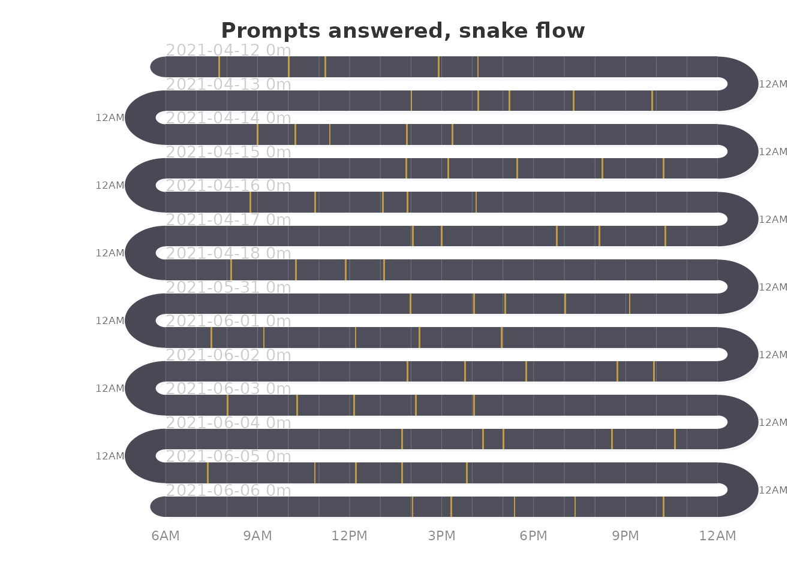
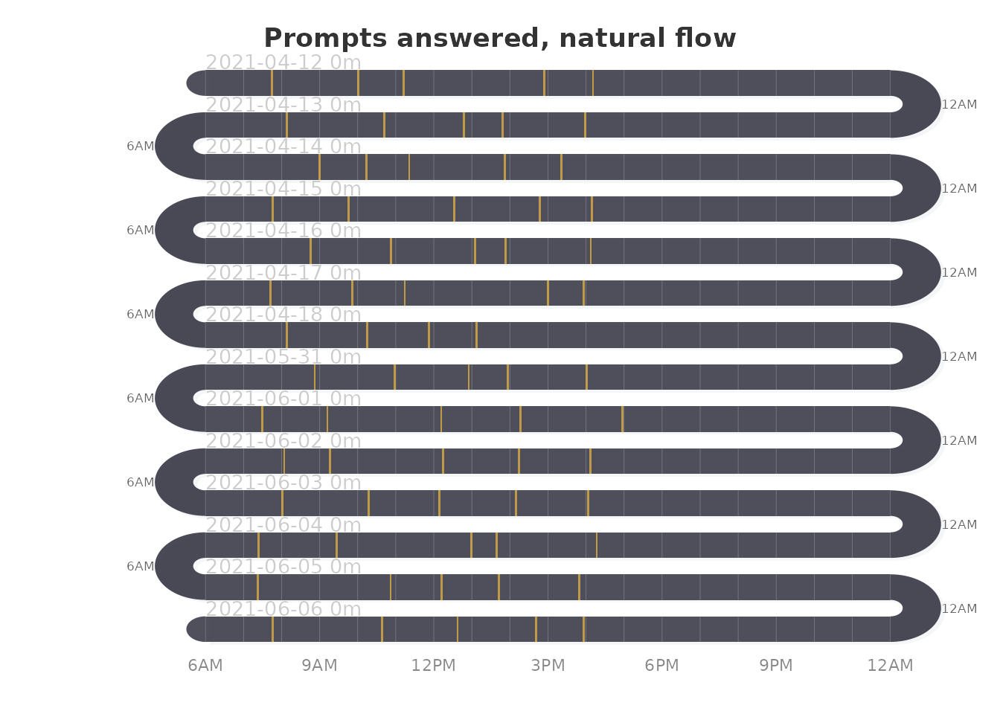
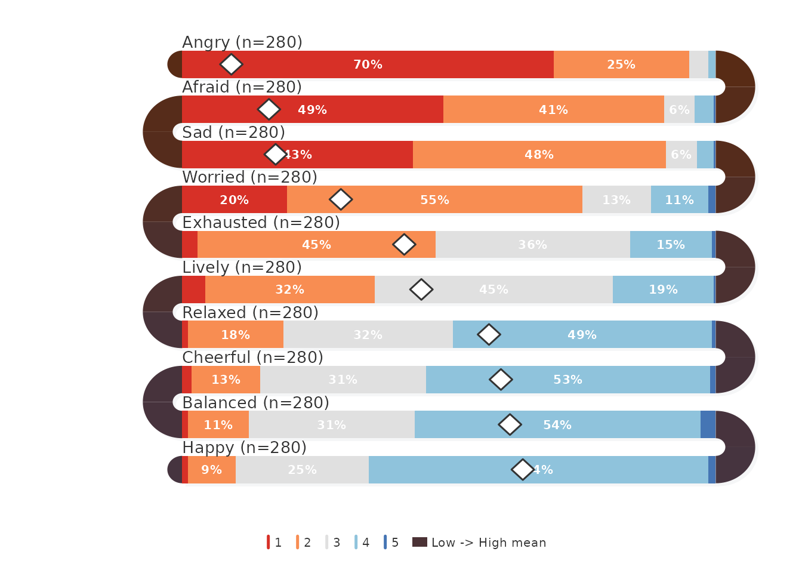
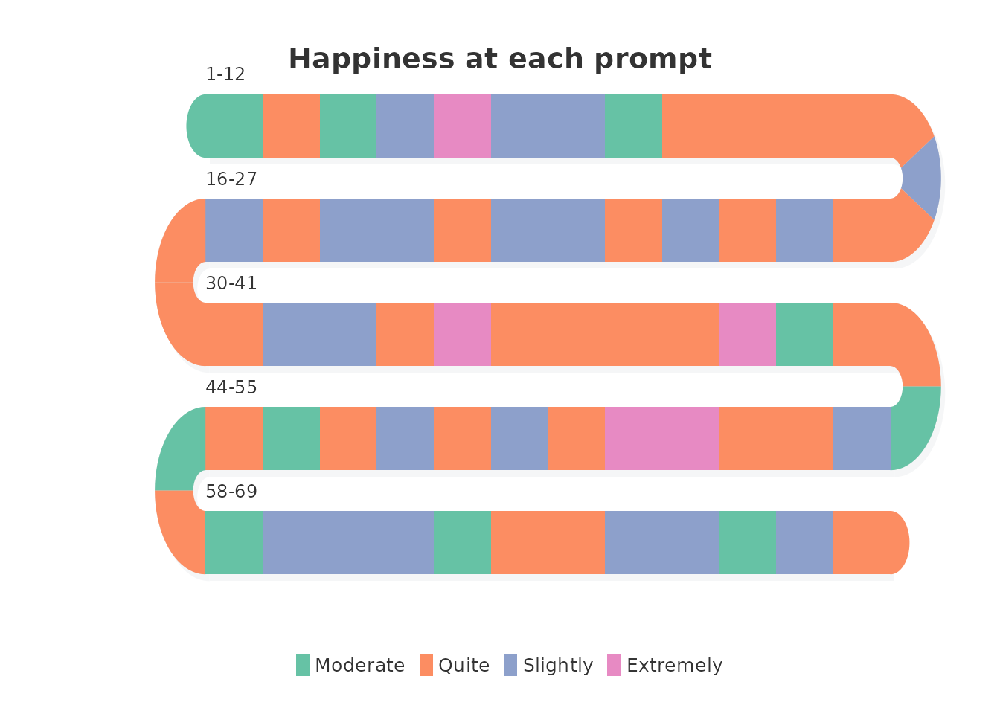
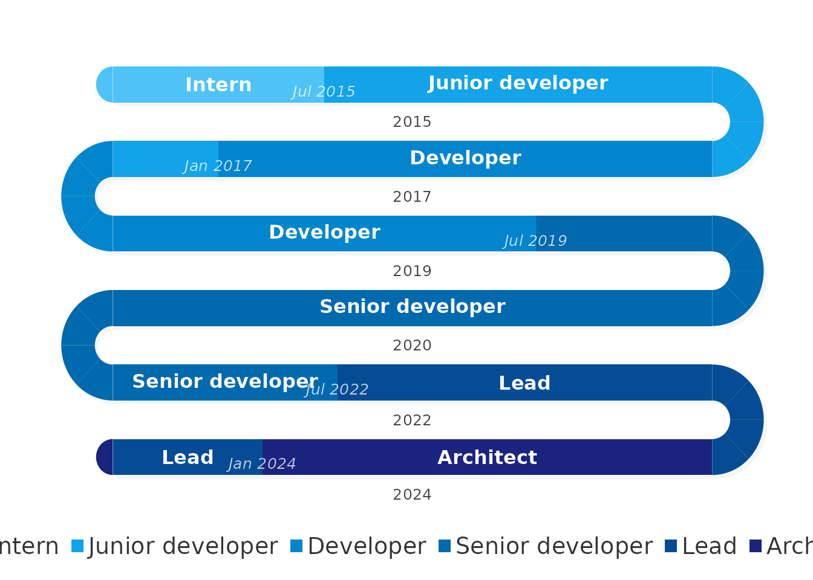

# Serpentine plots

Many data in the behavioral and learning sciences are long and ordered:
a two-week record of experience sampling prompts, the actions of a
learner in one session, the phases of a career, or a questionnaire of
thirty items. Drawn on a single axis, such data either outgrow the page
or are compressed until individual observations can no longer be
distinguished. Cutting the axis into separate panels keeps the
resolution but breaks the order at every cut.

A serpentine plot folds the axis instead of cutting it. The ordered axis
is divided into segments that are drawn as horizontal bands, one below
the other, and consecutive bands are joined by a U-turn arc, so the
reader follows one continuous path from the first observation to the
last. The bands share a common scale, which makes the plot a stack of
small multiples at the same time: positions can be compared down the
page as well as along the path. The `snakeplot` package draws serpentine
plots for survey responses, experience sampling data, categorical
sequences, timelines and time-stamped activity, all with base R
graphics.

``` r

library(snakeplot)
```

## Data

The package includes three datasets from a 14-day experience sampling
study of university students (Neubauer & Schmiedek, 2024), rescaled from
a 1–7 to a 1–5 scale.

- **`ema_emotions`:** 280 students by 10 emotion items; each value is a
  student’s mean rating over the study, rounded.
- **`student_survey`:** the same 280 students by 34 items in four
  constructs, with the construct as a column prefix (`Emo_`, `Mot_`,
  `Reg_`, `Eng_`).
- **`ema_beeps`:** 11,474 answered prompts from 321 students, with the
  student (`id`), the study day (`day`), the time of answering
  (`start_time`) and two ratings (`happy`, `angry`).

The examples below follow one student through the study. Their rows are
selected once and reused:

``` r

student <- subset(ema_beeps, id == "xcVDLRQOwn")
xtabs(~ day, data = student)
#> day
#>  1  2  3  4  5  6  7  8  9 10 11 12 13 14 
#>  5  5  5  5  5  5  4  5  5  5  5  5  5  5
```

This student answered 69 prompts: five on every day except day 7, which
has four.

## The layout

A serpentine plot is defined by how the ordered axis is cut into bands
and in which direction each band is read. Bands are one unit each: one
item, one day, or one segment of a sequence. With `flow = "snake"`, the
direction alternates from band to band, as in boustrophedon writing, so
the end of each band is next to the start of the following one. With
`flow = "natural"`, every band reads in the same direction and the
U-turn carries the reader back to the starting side. `start_from`
chooses the side on which the first band begins.

[`activity_snake()`](https://pak.dynasite.org/Snakeplot/reference/activity_snake.md)
draws time-stamped events as ticks on a daily clock, one band per day.
In the default snake flow, the clock runs left to right on odd days and
right to left on even days:

``` r

activity_snake(student, flow = "snake", title = "Prompts answered, snake flow")
```



In the natural flow, the same clock time falls at the same horizontal
position on every day:

``` r

activity_snake(student, flow = "natural",
               title = "Prompts answered, natural flow")
```



The two flows trade continuity against alignment. Snake flow keeps
consecutive observations adjacent across a U-turn and suits data read as
one continuous sequence. Natural flow aligns a shared axis down the page
and suits data in which the position within a band has the same meaning
on every band, such as the time of day. The package uses natural flow by
default for sequences and timelines and snake flow for the other
displays; every function accepts both.

## Survey responses

For rating-scale data, each item is a band.
[`survey_snake()`](https://pak.dynasite.org/Snakeplot/reference/survey_snake.md)
places the responses of an item in zones whose widths are the shares of
the response levels, shades the band by the item mean, and marks the
mean with a diamond. With `tick_shape = "bar"` the zones become a
stacked bar with printed percentages.

``` r

survey_snake(ema_emotions, tick_shape = "bar", sort_by = "mean",
             colors = snake_palette("ocean", n = 5))
```



The [survey
vignette](https://pak.dynasite.org/Snakeplot/articles/survey-responses.html)
covers ticks, dots, response shares, correlation arcs between adjacent
items, construct panels and days as bands.

## Categorical sequences

A sequence of categorical states, such as the actions of a learner or
the ratings of one person over successive prompts, is drawn by
[`sequence_snake()`](https://pak.dynasite.org/Snakeplot/reference/sequence_snake.md)
as one block per position, colored by state. The student’s happiness
ratings, in the order in which the prompts were answered, form such a
sequence:

``` r

sequence_snake(with(student, factor(happy, levels = 1:5,
                                    labels = c("Not at all", "Slightly",
                                               "Moderate", "Quite",
                                               "Extremely"))),
               rows = 5, title = "Happiness at each prompt")
```



The counts behind the blocks:

``` r

xtabs(~ happy, data = student)
#> happy
#>  2  3  4  5 
#> 22 10 32  5
```

The student never reported the lowest level and reported “Quite” (4) at
32 of the 69 prompts, the most frequent state; “Extremely” occurred five
times.

## Timelines

A timeline is a small number of long phases with start and end dates.
[`timeline_snake()`](https://pak.dynasite.org/Snakeplot/reference/timeline_snake.md)
expands the phases into monthly blocks, labels each transition with its
date and each band with its year.

``` r

career <- data.frame(
  role  = c("Intern", "Junior developer", "Developer",
            "Senior developer", "Lead", "Architect"),
  start = c("2015-01", "2015-07", "2017-01", "2019-07", "2022-07",
            "2024-01"),
  end   = c("2015-06", "2016-12", "2019-06", "2022-06", "2023-12",
            "2024-12")
)
timeline_snake(career)
```



The [sequences
guide](https://pak.dynasite.org/Snakeplot/articles/sequences.html)
treats sequences, timelines and several sequences at once.

## Choosing a display

| Data | Function |
|----|----|
| Respondents by rating-scale items | [`survey_snake()`](https://pak.dynasite.org/Snakeplot/reference/survey_snake.md), [`survey_sequence()`](https://pak.dynasite.org/Snakeplot/reference/survey_sequence.md), [`sequential_dist()`](https://pak.dynasite.org/Snakeplot/reference/sequential_dist.md) |
| Prompts with a rating, a day and a time | `survey_snake(var =, day =, timestamp =)` |
| Time-stamped events | [`activity_snake()`](https://pak.dynasite.org/Snakeplot/reference/activity_snake.md) |
| A continuous signal over the day | [`line_snake()`](https://pak.dynasite.org/Snakeplot/reference/line_snake.md) |
| One ordered categorical sequence | [`sequence_snake()`](https://pak.dynasite.org/Snakeplot/reference/sequence_snake.md) |
| Several sequences | [`multi_snake()`](https://pak.dynasite.org/Snakeplot/reference/multi_snake.md) |
| Phases with start and end dates | [`timeline_snake()`](https://pak.dynasite.org/Snakeplot/reference/timeline_snake.md) |
| Any of these by group | [`facet_snake()`](https://pak.dynasite.org/Snakeplot/reference/facet_snake.md), or `survey_snake(facet = TRUE)` |

All functions draw with base graphics and return their layout invisibly;
colors come from
[`snake_palette()`](https://pak.dynasite.org/Snakeplot/reference/snake_palette.md),
described in the [palettes and layout
guide](https://pak.dynasite.org/Snakeplot/articles/palettes-and-layout.html).

## Further reading

- [Survey and experience sampling
  responses](https://pak.dynasite.org/Snakeplot/articles/survey-responses.html)
- [Categorical sequences and
  timelines](https://pak.dynasite.org/Snakeplot/articles/sequences.html)
- [Daily activity and continuous
  signals](https://pak.dynasite.org/Snakeplot/articles/activity.html)
- [Palettes, reading order and
  layout](https://pak.dynasite.org/Snakeplot/articles/palettes-and-layout.html)
- [Case study: daily emotions over fourteen
  days](https://pak.dynasite.org/Snakeplot/articles/case-daily-emotions.html)
- [Case study: a multi-construct student
  survey](https://pak.dynasite.org/Snakeplot/articles/case-student-survey.html)

## References

Neubauer, A. B., & Schmiedek, F. (2024). Approaching academic adjustment
on multiple time scales. *Zeitschrift für Erziehungswissenschaft*,
*27*(1), 147–168. <https://doi.org/10.1007/s11618-023-01182-8>
