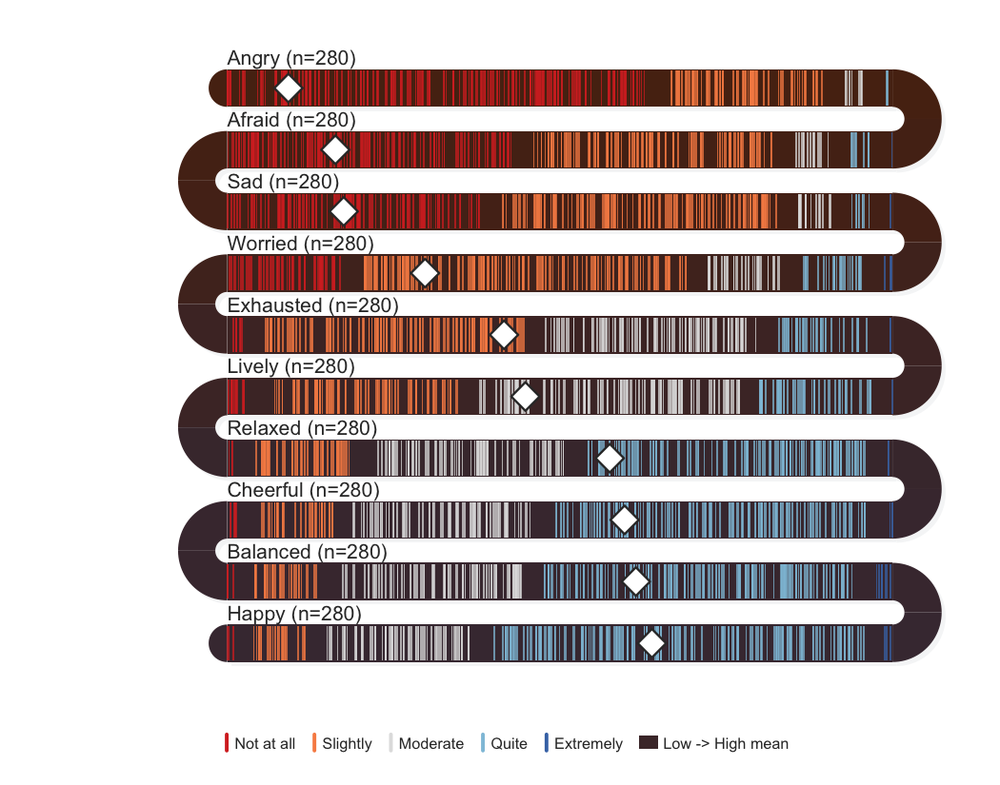
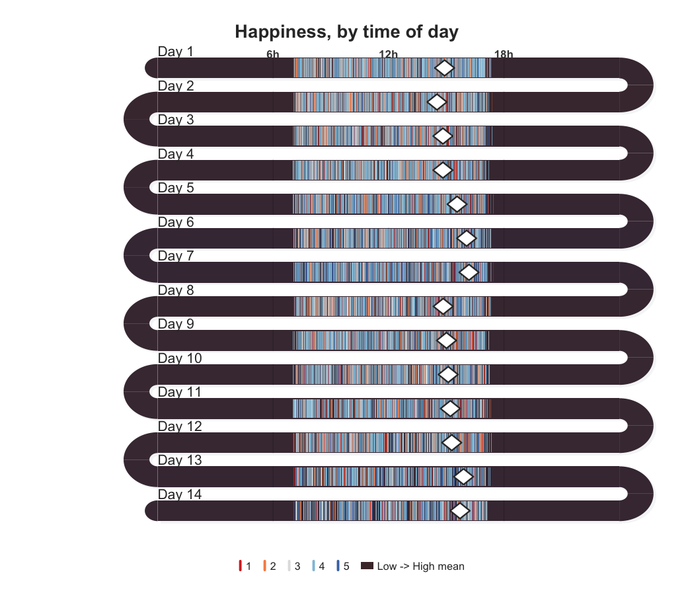
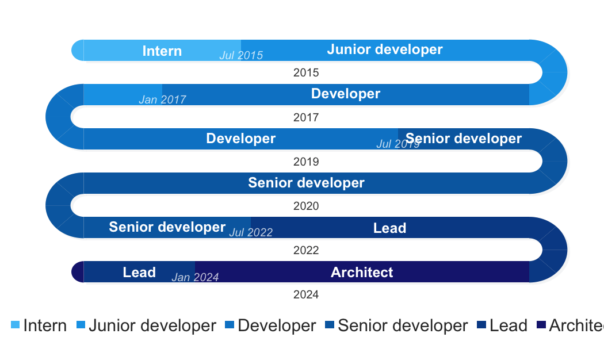

# snakeplot

## Vignettes and guides

**Vignettes**

- [Serpentine
  plots](https://pak.dynasite.org/Snakeplot/articles/snakeplot.html)
- [Survey and experience sampling
  responses](https://pak.dynasite.org/Snakeplot/articles/survey-responses.html)

**Guides**

- [Categorical sequences and
  timelines](https://pak.dynasite.org/Snakeplot/articles/sequences.html)
- [Daily activity and continuous
  signals](https://pak.dynasite.org/Snakeplot/articles/activity.html)
- [Palettes, reading order and
  layout](https://pak.dynasite.org/Snakeplot/articles/palettes-and-layout.html)

**Case studies**

- [Daily emotions over fourteen
  days](https://pak.dynasite.org/Snakeplot/articles/case-daily-emotions.html)
- [A multi-construct student
  survey](https://pak.dynasite.org/Snakeplot/articles/case-student-survey.html)

## Overview

`snakeplot` draws serpentine plots of long ordered data: a questionnaire
item by item, experience-sampling ratings day by day, categorical state
sequences, timelines of phases, and time-stamped daily activity. The
ordered axis is folded into horizontal bands joined by U-turn arcs, so a
long record fits one panel with its order kept and neighbouring segments
can be compared directly. A survey snake plot shows the response
distribution of each item as ticks, dots or stacked bars, with the item
mean, an optional median and the correlation between adjacent items; an
activity snake plot gives each study day its own band and places each
prompt at its time of day.

All plots use base R graphics, and the package has no dependencies
beyond those that ship with R.

## The serpentine layout

An ordered axis, whether of items, days or positions in a sequence, is
cut into bands of equal length that share one scale. With
`flow = "snake"` the reading direction alternates from band to band, as
in boustrophedon writing, so the end of each band is adjacent to the
start of the next. With `flow = "natural"` every band reads in the same
direction, so a position within a band, such as a time of day, has the
same horizontal location on every band. The first arrangement keeps the
sequence continuous across the U-turns; the second aligns a shared axis
down the page. Each band is a unit of comparison (an item, a day, a
segment of a sequence), and the band shading, the U-turn arcs and the
legend encode summaries of the units they join.

## Installation

``` r

install.packages("snakeplot")

# development version
install.packages("remotes")
remotes::install_github("mohsaqr/snakeplot")
```

## Example data

The package includes three datasets from a 14-day experience sampling
study of university students (Neubauer & Schmiedek, 2024), rescaled to a
1–5 scale: `ema_emotions` (280 students by 10 emotion items, each a
student’s mean rating over the study), `student_survey` (the same
students by 34 items in four constructs) and `ema_beeps` (11,474
answered prompts from 321 students, with day, time and two ratings).

## Survey responses

Each item is a band. The widths of the colored zones are the shares of
the response levels, the ticks are the individual responses, and the
diamond marks the item mean. Sorting by the mean orders the items from
the least to the most endorsed.

``` r

library(snakeplot)

survey_snake(ema_emotions, sort_by = "mean",
             colors = snake_palette("ocean", n = 5),
             level_labels = c("1" = "Not at all", "2" = "Slightly",
                              "3" = "Moderate", "4" = "Quite",
                              "5" = "Extremely"))
```



plot of chunk survey

## Experience sampling by day

With `var` and `day`, beep-level data are drawn as one band per study
day for one rating; `timestamp` places each answered prompt at its time
of day.

``` r

survey_snake(ema_beeps, var = "happy", day = "day",
             timestamp = "start_time",
             colors = snake_palette("ocean", n = 5),
             title = "Happiness, by time of day")
```



plot of chunk daily

## Sequences and timelines

[`sequence_snake()`](https://pak.dynasite.org/Snakeplot/reference/sequence_snake.md)
folds an ordered categorical sequence into bands of blocks colored by
state;
[`timeline_snake()`](https://pak.dynasite.org/Snakeplot/reference/timeline_snake.md)
draws phases with start and end dates as monthly blocks with labelled
transitions.

``` r

career <- data.frame(
  role  = c("Intern", "Junior developer", "Developer",
            "Senior developer", "Lead", "Architect"),
  start = c("2015-01", "2015-07", "2017-01", "2019-07", "2022-07",
            "2024-01"),
  end   = c("2015-06", "2016-12", "2019-06", "2022-06", "2023-12",
            "2024-12")
)
timeline_snake(career)
```



plot of chunk timeline

## Authors and citation

`snakeplot` is written by [Mohammed Saqr](https://saqr.me) and [Sonsoles
López-Pernas](https://sonsoles.me). Mohammed Saqr maintains the package.
Questions and bug reports can be submitted through the [repository issue
tracker](https://github.com/mohsaqr/snakeplot/issues). The package
citation is available through `citation("snakeplot")`.

The bundled data are derived from Neubauer, A. B., & Schmiedek, F.
(2024). Approaching academic adjustment on multiple time scales.
*Zeitschrift für Erziehungswissenschaft*, *27*(1), 147–168.
<https://doi.org/10.1007/s11618-023-01182-8>
([data](https://osf.io/bhq3p), [codebook](https://osf.io/csfwg), CC-BY
4.0).
